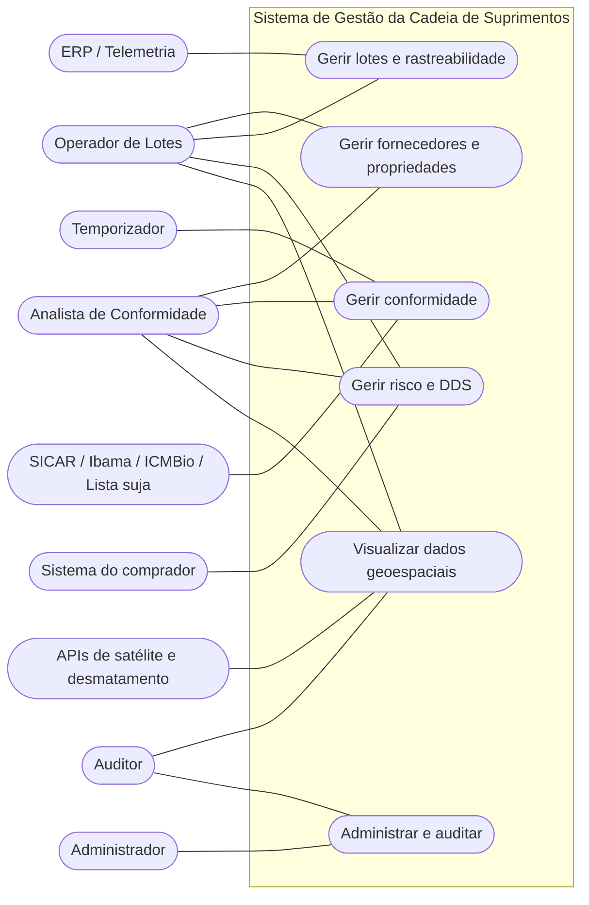
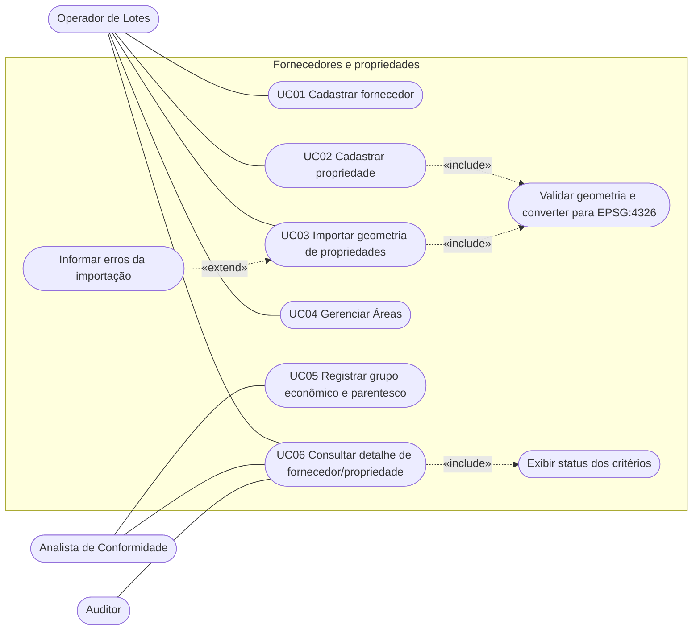
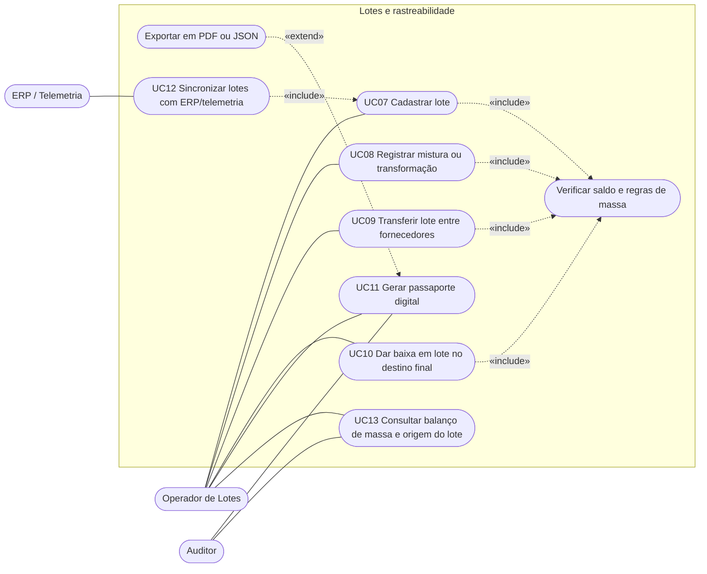
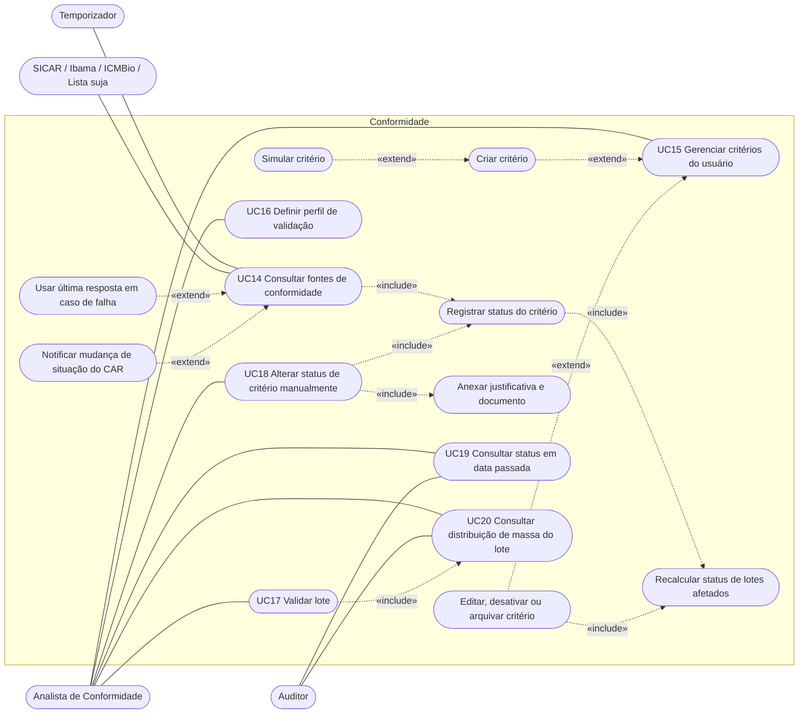
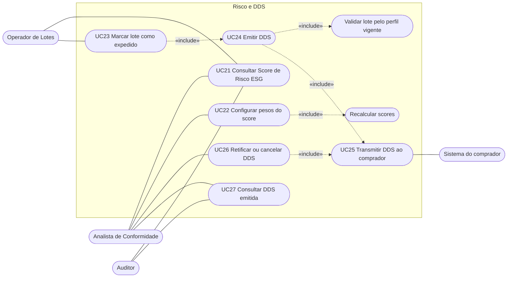
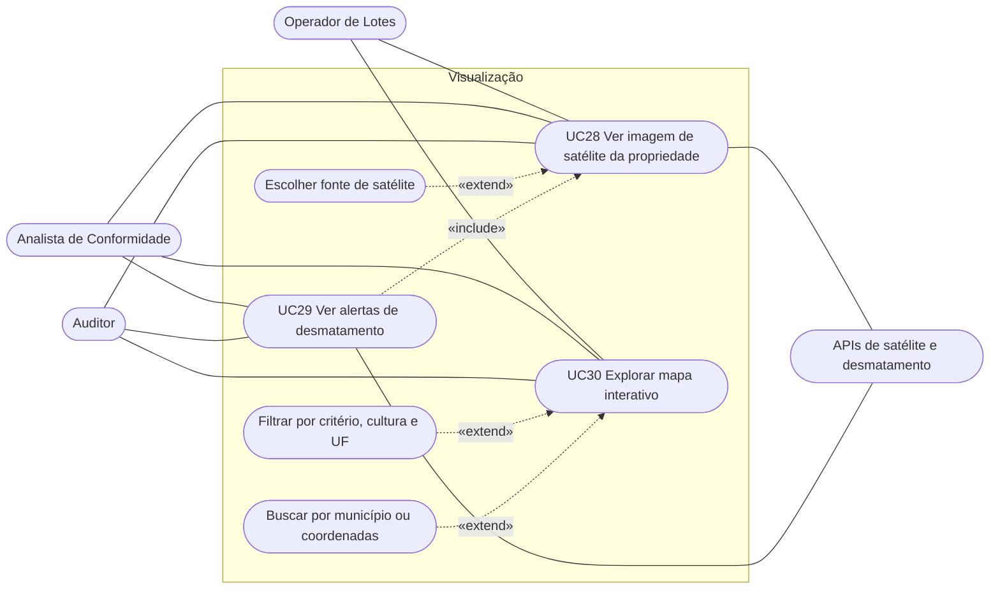
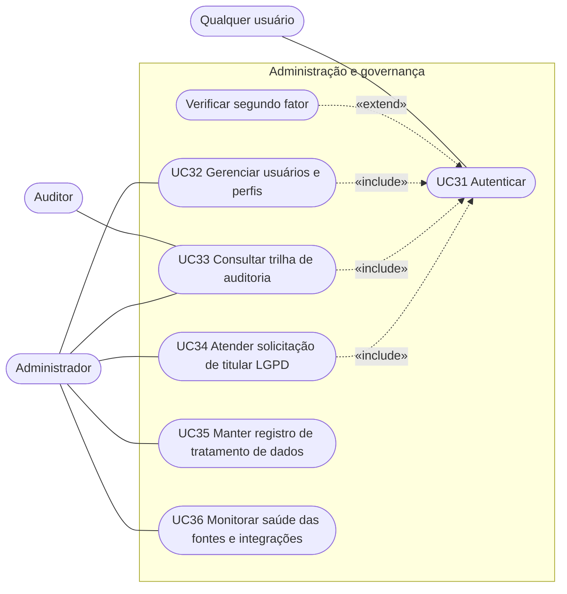

# Casos de Uso

Diagramas de casos de uso do sistema, em Mermaid. O Mermaid não tem diagrama de casos de uso nativo, então usa-se `flowchart`:

- **Atores:** retângulos de cantos arredondados fora da fronteira do sistema.
- **Casos de uso:** elipses (`([ ])`) dentro do subgrafo "Sistema".
- **Associação:** seta contínua. **Include/extend:** seta tracejada com estereótipo. A seta de `«extend»` sai do caso que estende e aponta para o caso-base.

## Atores

| Ator | Tipo | Descrição |
|---|---|---|
| Administrador | Humano | Gerencia usuários, perfis e configuração do sistema (RNF-12). |
| Analista de Conformidade | Humano | Gerencia critérios, perfil de validação, status manual, score e DDS (RF-13.7, RN-12). Em "Analista ou superior", o Administrador herda estas permissões. |
| Operador de Lotes | Humano | Cadastra fornecedores, propriedades e lotes e registra movimentações (RNF-12). |
| Auditor | Humano | Acesso somente leitura, incluindo a trilha de auditoria (RNF-12). |
| Temporizador | Sistema | Dispara consultas diárias e reprocessamentos (RF-07.1, RF-08.1, RF-08.2, RNF-09.2). |
| SICAR · Ibama/ICMBio · Lista suja | Externo | Fontes de conformidade (RF-07.1, RF-08.x). |
| APIs de satélite e desmatamento | Externo | Imagens e alertas (RF-04.x). |
| ERP / Telemetria | Externo | Origem de lotes automáticos (RF-12). |
| Sistema do comprador | Externo | Destino da DDS (RF-09.2). |

Todos os casos de uso humanos pressupõem **Autenticar** (RNF-10). Não é desenhado em cada diagrama para não poluí-los; aparece no diagrama 6.

---

## 0. Visão geral

Cada caso de uso representa um módulo, detalhado nos diagramas seguintes.

---

## 1. Fornecedores e propriedades

Cobre: RF-01.1 a RF-01.5, RF-06.1, RF-06.2, RF-10.1, RNF-22.2, RN-13.

---

## 2. Lotes e rastreabilidade

Cobre: RF-02.1 a RF-02.5, RF-12, RN-01, RN-03 a RN-07, RN-16, RN-17, RNF-01.x. "Verificar saldo e regras de massa" é a verificação compartilhada de RN-01, RN-03, RN-04 e RN-06.

---

## 3. Conformidade

Cobre: RF-07.1, RF-07.2, RF-08.1 a RF-08.3, RF-03.1, RF-03.2, RF-13.1 a RF-13.9, RN-09 a RN-12, RN-14, RN-24 a RN-30, RNF-09.x, RNF-28. O recálculo (RF-13.4, RN-10) é comportamento interno, detalhado em diagrama de atividade/sequência, não em caso de uso.

---

## 4. Risco e DDS

Cobre: RF-11.1, RF-11.2, RF-09.1, RF-09.2, RN-18 a RN-22, RNF-04, RNF-18. O sistema do comprador participa de UC25. UC23, UC26 e UC27 não têm RF próprio (ver lacunas).

---

## 5. Visualização geoespacial

Cobre: RF-04.1, RF-04.2, RF-05.1 a RF-05.3, RNF-02.x, RNF-09.1.

---

## 6. Administração e governança

Cobre: RNF-10 a RNF-12, RNF-15.x, RNF-16.x, RNF-27.2, RNF-28. Todos os demais casos de uso humanos também incluem UC31, omitido nos outros diagramas.

---

## Rastreabilidade (caso de uso → requisitos)

| UC | Caso de uso | Requisitos |
|---|---|---|
| UC01 | Cadastrar fornecedor | RF-01.1 |
| UC02 | Cadastrar propriedade | RF-01.2, RF-01.3, RNF-22.1 |
| UC03 | Importar geometria | RF-06.1, RF-06.2, RNF-06, RNF-22.2, RN-13 |
| UC04 | Gerenciar Áreas | RF-01.5 |
| UC05 | Registrar grupo econômico | RF-10.1, RF-10.2, RN-11 |
| UC06 | Consultar detalhe | RF-01.3, RF-01.4 |
| UC07 | Cadastrar lote | RF-02.1, RN-06, RN-07, RN-16 |
| UC08 | Registrar mistura/transformação | RF-02.2, RF-02.3, RN-01, RN-03, RN-04 |
| UC09 | Transferir lote entre fornecedores | RN-17, RN-02 |
| UC10 | Dar baixa | RF-02.4, RN-05 |
| UC11 | Gerar passaporte | RF-02.5 |
| UC12 | Sincronizar com ERP | RF-12, RNF-01.x |
| UC13 | Consultar balanço e origem | RF-02.3, RF-02.2 |
| UC14 | Consultar fontes | RF-07.1, RF-07.2, RF-08.1 a RF-08.3, RNF-09.x, RN-14 |
| UC15 | Gerenciar critérios do usuário | RF-13.7 a RF-13.9, RN-27 a RN-30 |
| UC16 | Definir perfil de validação | RF-03.1, RN-20 |
| UC17 | Validar lote | RF-03.2, RF-13.3, RNF-03 |
| UC18 | Alterar status manualmente | RN-12 |
| UC19 | Consultar status passado | RF-13.5, RN-24 |
| UC20 | Consultar distribuição de massa | RF-13.6 |
| UC21 | Consultar score | RF-11.1, RN-19 |
| UC22 | Configurar pesos | RF-11.2, RN-18, RNF-04 |
| UC23 | Marcar lote como expedido | gatilho de RF-09.1 |
| UC24 | Emitir DDS | RF-09.1, RN-21, RN-22 |
| UC25 | Transmitir DDS | RF-09.2 |
| UC26 | Retificar/cancelar DDS | RN-22 |
| UC27 | Consultar DDS | RN-22, RNF-18 |
| UC28 | Ver imagem de satélite | RF-04.1 |
| UC29 | Ver alertas de desmatamento | RF-04.2 |
| UC30 | Explorar mapa | RF-05.1 a RF-05.3 |
| UC31 | Autenticar | RNF-10, RNF-11 |
| UC32 | Gerenciar usuários e perfis | RNF-12 |
| UC33 | Consultar trilha de auditoria | RNF-15.1 a RNF-15.3 |
| UC34 | Atender solicitação de titular | RNF-16.3, RNF-15.3 |
| UC35 | Manter registro de tratamento | RNF-16.1, RNF-16.2 |
| UC36 | Monitorar fontes e integrações | RNF-27.2, RNF-28 |

## Lacunas de requisitos

Estes casos de uso não têm RF próprio, só regra de negócio ou RNF. Decidir se viram RFs ou se ficam como derivados:

- UC18 (RN-12), UC23 (gatilho de RF-09.1), UC26 (RN-22), UC27, UC32 (RNF-12), UC33 (RNF-15.1), UC34 (RNF-16.3), UC35 (RNF-16.1) e UC36 (RNF-28).
