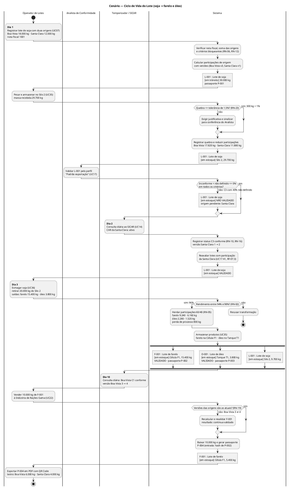

# Cenário — Ciclo de Vida do Lote

| Campo | Valor |
|---|---|
| **Tipo** | Cenário de ponta a ponta. Não é um caso de uso: encadeia casos de uso do sistema ao longo de vários dias e com atores diferentes |
| **Participantes** | Operador de Lotes, Analista de Conformidade, Temporizador «sistema», SICAR «externo» |
| **Estágio** | Piloto |
| **Casos de uso encadeados** | [UC07](uc07-registrar-lotes.md) → [UC35](uc35-armazenar-lote.md) → [UC17](uc17-validar-conformidade.md) → UC14 → [UC36](uc36-transformar-lote.md) (com UC35) → [UC22](uc22-vender-lote.md) |
| **Requisitos** | RF-03.1, RF-05.1, RF-05.3, RF-05.5, RF-05.6, RF-05.9, RF-05.10, RF-05.11, RF-06.2, RF-07.2, RF-07.3, RF-13.2 |
| **Regras de negócio** | RN-01, RN-02, RN-05, RN-06, RN-10, RN-16, RN-18, RN-19, RN-20, RN-21, RN-23 |
| **Diagrama de atividades** | [`plantuml/cenario-ciclo-de-vida-do-lote.puml`](plantuml/cenario-ciclo-de-vida-do-lote.puml): raias por participante e nós de objeto com o estado de cada lote |
| **Estados do lote** | [Máquina de estados do Lote](../diagrams/plantuml/estados-lote.png) ([`.puml`](../diagrams/plantuml/estados-lote.puml)): vale para qualquer lote, não só para este exemplo |

## Objetivo

Mostrar um ciclo de vida completo e possível de um lote: da entrada de soja com **lastro de origem** (as propriedades e fornecedores de onde vem cada quilo), passando por armazenagem, validação, processamento em farelo e óleo, até a venda do farelo. Ao final, o comprador recebe um passaporte que prova de que propriedades veio a massa comprada e qual era o status de conformidade de cada origem na data da venda.

## Dados do exemplo

Todos os nomes são fictícios. Massas em kg inteiros (RNF-19).

**Origens**

| Fornecedor | Propriedade | Embargo Ibama (C1, propriedade) | Lista suja (C2, fornecedor) | Situação do CAR (C3, propriedade) | Versão inicial |
|---|---|---|---|---|---|
| Produtor Alfa | Fazenda Boa Vista | conforme | conforme | conforme (CAR ativo) | 3 |
| Produtor Beta | Fazenda Santa Clara | conforme | conforme | **não definido** (propriedade recém-cadastrada, CAR ainda não consultado) | 1 |

**Configuração da empresa**

| Item | Valor |
|---|---|
| Perfil de validação vigente | "Padrão exportação": C1, C2 e C3 ativos, tolerância 0% de massa inconforme e não definida |
| Produtos (RF-05.11) | Soja (cultura, tolerância de quebra 1,5%), Farelo de soja (derivado), Óleo de soja (derivado) |
| Tipo de processo (RF-05.11) | "Esmagamento de soja": entrada soja; saídas farelo e óleo; rendimento entre 94% e 98% |
| Unidades de armazenagem (RF-05.9) | Armazém Central: Silo 2 (soja, 500.000 kg), Célula F1 (farelo, 200.000 kg), Tanque T1 (óleo, 80.000 kg); todas vazias |
| Comprador | Indústria de Rações Gama |

## Pré-condições

1. Fornecedores, propriedades, produtos, tipo de processo, unidades de armazenagem, perfil de validação e comprador estão cadastrados.
2. Nenhuma das propriedades de origem está inconforme em critério bloqueante (RN-06).

## Pós-condições

1. 10.000 kg de farelo foram vendidos e baixados, com passaporte da venda que leva, pela cadeia de hashes, até as duas propriedades de origem.
2. Continuam em estoque: 9.700 kg de soja no Silo 2, 5.400 kg de farelo na Célula F1 e 3.800 kg de óleo no Tanque T1, todos com participações de origem e status rastreáveis.
3. Todas as etapas estão na trilha de auditoria.

## Cenário passo a passo

### Etapa 1 — Registrar o lote de soja com lastro de origem (UC07), dia 1

1. O Operador registra o lote **L-001**: soja, 30.000 kg, nota fiscal 1001, com duas origens: Fazenda Boa Vista, 18.000 kg, e Fazenda Santa Clara, 12.000 kg.
2. O sistema verifica a nota fiscal (RN-12), a soma das origens e os critérios bloqueantes (RN-06). Tudo ok.
3. O sistema calcula as participações de origem, com a versão de cada origem:

| Participação | Massa | Versão registrada |
|---|---|---|
| Fazenda Boa Vista / Produtor Alfa | 18.000 kg (60%) | 3 |
| Fazenda Santa Clara / Produtor Beta | 12.000 kg (40%) | 1 |

4. O lote fica **em trânsito**. O sistema gera o passaporte **P-001** (etapa cadastro).
5. Distribuição de massa no C3 (Situação do CAR): 18.000 kg conforme e 12.000 kg **não definido** (RN-18).

### Etapa 2 — Receber e armazenar no silo (UC35), dia 1

1. O caminhão chega ao Armazém Central. O Operador informa o Silo 2, a pesagem de 29.700 kg e o ticket de balança T-555.
2. Quebra de 300 kg (1,0%), dentro da tolerância de 1,5% da soja (RN-23): não exige justificativa.
3. O sistema registra a quebra como saída e reduz as participações na mesma proporção (RN-05): Boa Vista 17.820 kg e Santa Clara 11.880 kg.
4. O lote L-001 fica **em estoque** no Silo 2, com 29.700 kg.

### Etapa 3 — Validar a conformidade (UC17), dia 1

1. O Analista valida L-001 pelo perfil "Padrão exportação".

| Critério | Conforme | Inconforme | Não definido | Tolerância | Resultado |
|---|---|---|---|---|---|
| C1 Embargo Ibama | 29.700 kg | 0 | 0 | 0% | atendida |
| C2 Lista suja | 29.700 kg | 0 | 0 | 0% | atendida |
| C3 Situação do CAR | 17.820 kg | 0 | **11.880 kg (40%)** | 0% | **falhou** |

2. Resultado: **não validado**. O sistema aponta a Fazenda Santa Clara como origem da massa não definida.

### Etapa 4 — Consulta diária e reavaliação automática (UC14 e UC17 A1), dia 2

1. O Temporizador dispara a consulta diária ao SICAR (RF-03.1). O CAR da Fazenda Santa Clara está **ativo**: o sistema registra um novo status de C3, **conforme** (RN-10, RN-16), e a versão da Santa Clara passa de 1 para 2.
2. O evento `StatusCriterioRegistrado` dispara a reavaliação dos lotes com participação da Santa Clara (RF-07.3). L-001 agora tem 29.700 kg conformes em C3 e passa a **validado**. As versões registradas nas participações são atualizadas.

### Etapa 5 — Processar soja em farelo e óleo (UC36), dia 3

1. O Operador registra uma transformação "Esmagamento de soja", **retirando** 20.000 kg do L-001 no Silo 2 (retirada parcial, UC36 A2).
2. Saídas informadas: farelo **F-001** com 15.400 kg e óleo **O-001** com 3.800 kg. Total de 19.200 kg: rendimento de 96%, dentro da faixa de 94% a 98% (RN-02). Perda de processo de 800 kg.
3. O sistema calcula as participações herdadas, na proporção 60% / 40% da massa retirada (RN-05):

| Lote | Massa | Boa Vista / Alfa | Santa Clara / Beta | Local |
|---|---|---|---|---|
| L-001 (saldo) | 9.700 kg | 5.820 kg | 3.880 kg | Silo 2 |
| F-001 farelo | 15.400 kg | 9.240 kg | 6.160 kg | Célula F1 |
| O-001 óleo | 3.800 kg | 2.280 kg | 1.520 kg | Tanque T1 |

4. F-001 e O-001 são armazenados pelo UC35, a partir do passo 3, sem pesagem de chegada, na Célula F1 e no Tanque T1, que estavam vazios.
5. O sistema gera os passaportes **P-002** (F-001) e **P-003** (O-001), ambos com o hash de P-001 como entrada (RF-05.5). Os dois lotes de produto estão **validados**: todas as origens estão conformes nos três critérios.

### Etapa 6 — Nova consulta antes da venda (UC14), dia 10

1. A consulta diária registra uma nova avaliação de C1 para a Fazenda Boa Vista, novamente **conforme**. Mesmo sem mudança de valor, a versão da Boa Vista passa de 3 para 4 (RN-16).

### Etapa 7 — Vender o farelo (UC22), dia 10

1. O Operador vende 10.000 kg de F-001 à Indústria de Rações Gama, com nota fiscal 2002.
2. Na verificação de versão (RN-19), a versão registrada da Boa Vista (3) é diferente da atual (4). O sistema recalcula a distribuição e revalida F-001 (UC22 A2): o resultado continua **validado**, sem mudança, e a venda prossegue sem nova confirmação.
3. O sistema baixa 10.000 kg de F-001. Restam 5.400 kg na Célula F1 (Boa Vista 3.240 kg, Santa Clara 2.160 kg).
4. O sistema gera o passaporte da venda **P-004**, com o hash de P-002 como entrada e os status vigentes no dia 10 (RN-21). O Operador exporta o passaporte em PDF com QR Code para o comprador.

## Linha do tempo

| Dia | Etapa | Caso de uso | L-001 (soja) | F-001 (farelo) | O-001 (óleo) | Passaporte |
|---|---|---|---|---|---|---|
| 1 | Registro | UC07 | em trânsito, 30.000 kg, não validado | — | — | P-001 |
| 1 | Armazenagem | UC35 | em estoque, Silo 2, 29.700 kg | — | — | — |
| 1 | Validação | UC17 | não validado (C3) | — | — | — |
| 2 | Consulta SICAR | UC14 → UC17 | validado | — | — | — |
| 3 | Transformação | UC36 + UC35 | em estoque, 9.700 kg | em estoque, Célula F1, 15.400 kg | em estoque, Tanque T1, 3.800 kg | P-002, P-003 |
| 10 | Venda | UC22 | — | em estoque, 5.400 kg (10.000 kg vendidos) | — | P-004 |

## Lastro de origem da venda

Seguindo P-004 → P-002 → P-001, o comprador comprova a origem dos 10.000 kg de farelo:

| Origem | Massa no farelo vendido | C1 | C2 | C3 (no dia 10) |
|---|---|---|---|---|
| Fazenda Boa Vista / Produtor Alfa | 6.000 kg (60%) | conforme | conforme | conforme |
| Fazenda Santa Clara / Produtor Beta | 4.000 kg (40%) | conforme | conforme | conforme |

## Variações do cenário

| Se... | Então... | Fluxo |
|---|---|---|
| no dia 2 o CAR da Santa Clara viesse **cancelado** | C3 fica inconforme; L-001 continua não validado; F-001 e O-001 nascem não validados; a venda exige confirmação de lote não validado | RN-10, UC22 A3 |
| a pesagem passasse de 1,5% de quebra | o Operador precisa justificar e o recebimento fica sinalizado para o Analista | RN-23, UC35 E2 |
| o Silo 2 já tivesse soja de outro lote | a armazenagem vira mistura, com novo lote e participações combinadas | UC35 A1, UC08 |
| o caminhão fosse direto para a esmagadora | o lote é recebido sem passar pelo silo e entra no processo | UC36 A1 |
| o rendimento informado fosse 99% | a transformação é recusada por estar fora da faixa do tipo de processo | RN-02, UC36 E1 |
