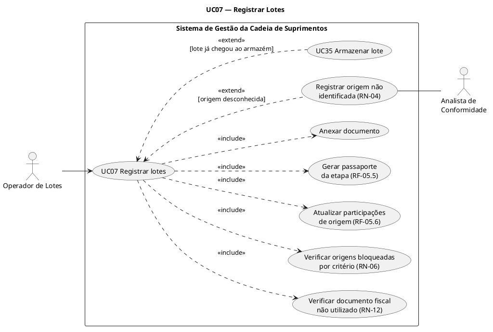

# UC07 — Registrar Lotes

| Campo | Valor |
|---|---|
| **Módulo** | Lotes e rastreabilidade |
| **Ator principal** | Operador de Lotes (no Demo, Usuário) |
| **Atores secundários** | — |
| **Estágio** | Demo (cadastro básico); Piloto (participações, passaporte, regras de massa) |
| **Requisitos** | RF-05.1, RF-05.3, RF-05.5, RF-05.6, RF-12.1, RF-07.2 |
| **Regras de negócio** | RN-04, RN-06, RN-12, RN-17, RN-21 |
| **Não funcionais** | RNF-10.1, RNF-11, RNF-18, RNF-19, RNF-22 |
| **Diagrama de casos de uso** | [`plantuml/uc07-registrar-lotes.puml`](plantuml/uc07-registrar-lotes.puml) |

## Objetivo

Registrar um lote de entrada, isto é, uma carga de grãos que sai de uma ou mais propriedades de fornecedores em direção à empresa, com massa, documento fiscal e origens, de modo que o lote fique rastreável até as propriedades e tenha status de conformidade desde o primeiro momento.

## Pré-condições

1. O usuário está autenticado e pertence à empresa que receberá o lote (RNF-18).
2. O usuário tem perfil Operador de Lotes ou superior (no Demo, Usuário ou Administrador).
3. O fornecedor e as propriedades de origem estão cadastrados.

## Pós-condições

**Sucesso**
1. O lote está gravado com situação **em trânsito**, massa em kg inteiros (RNF-19) e suas procedências (propriedade e massa de cada origem).
2. As **participações de origem** do lote estão calculadas, cada uma com a versão de status da origem usada no cálculo (RF-05.6).
3. O documento fiscal está anexado ao lote (RF-12.1).
4. Um evento `LoteMovimentado` e o registro de auditoria foram gravados na mesma transação (RNF-10.1, RNF-22).
5. O **passaporte da etapa de cadastro** é gerado em seguida, com hash sobre JSON canônico (RF-05.5, RNF-11).

**Falha**
- Nada é gravado: lote, procedências, documento, evento e auditoria são desfeitos juntos.

## Fluxo principal

1. O Operador escolhe **Novo lote de entrada**.
2. O sistema exibe o formulário com as culturas disponíveis e os parâmetros de qualidade configurados pela empresa.
3. O Operador informa identificação, cultura, data, massa total, parâmetros de qualidade (ex.: umidade, impureza) e o número do documento fiscal ou de transporte.
4. O Operador informa a propriedade de origem e a massa vinda dela.
5. O Operador anexa o documento fiscal (PDF ou imagem).
6. O Operador confirma.
7. O sistema valida o lote:
   1. o documento fiscal não está vinculado a outro lote de entrada (RN-12);
   2. a soma das massas das origens é igual à massa total do lote;
   3. nenhuma propriedade ou fornecedor de origem está **inconforme em critério bloqueante** (RN-06).
8. O sistema calcula as participações de origem (uma por propriedade e fornecedor), registrando a versão de status atual de cada origem (RF-05.6).
9. O sistema grava, em uma única transação, o lote (situação em trânsito), as procedências, as participações, o documento, o evento `LoteMovimentado` e o registro de auditoria.
10. O sistema exibe o detalhe do lote com a distribuição de massa por critério (conforme, inconforme, não definido), calculada a partir das participações e do status vigente de cada origem (RF-07.2), e o passaporte com a indicação "em geração".
11. O sistema gera o passaporte da etapa de cadastro, com os status vigentes na data (RN-21), e atualiza o detalhe do lote. O caso de uso termina.

## Fluxos alternativos

**A1 — Várias propriedades de origem** (passo 4)
1. O Operador adiciona outra propriedade e a respectiva massa.
2. Volta ao passo 4 até todas as origens serem informadas; segue para o passo 5.

**A2 — Lote já chegou ao armazém** (passo 11)
1. O Operador escolhe **Armazenar** no detalhe do lote.
2. O sistema inicia o [UC35 — Armazenar Lote](uc35-armazenar-lote.md).

**A3 — Origem ainda não identificada** (passo 4)
1. O Operador marca a origem como "não identificada" e informa uma justificativa.
2. O sistema registra o lote **bloqueado para saída** até a regularização (RN-04), toda a massa como **não definida** em todos os critérios (RN-18), e notifica o Analista de Conformidade.
3. Segue para o passo 5.

## Fluxos de exceção

**E1 — Documento fiscal já usado** (passo 7.1)
- O sistema recusa o registro, informa o lote ao qual o documento já está vinculado e volta ao passo 3.

**E2 — Soma das origens diferente da massa total** (passo 7.2)
- O sistema mostra a diferença em kg e volta ao passo 4.

**E3 — Origem inconforme em critério bloqueante** (passo 7.3)
- O sistema recusa o registro e informa, para cada origem bloqueada, o critério, o status, a data da avaliação e a fonte. Sugere ao Analista a regularização (alteração manual de status com justificativa, RF-07.5). O caso de uso termina sem gravar.

**E4 — Falha na gravação** (passo 9)
- A transação é desfeita, nada é gravado, e o sistema informa o erro e mantém os dados do formulário para nova tentativa.

## Regras e observações

- As massas são digitadas em toneladas ou kg e gravadas em kg inteiros, sem arredondamento no balanço (RNF-19).
- Cada critério é avaliado no seu nível de aplicação: critérios de propriedade usam a propriedade; critérios de fornecedor usam o fornecedor (RN-17).
- O passaporte é gerado por reação ao evento (ADR-002). Uma etapa seguinte só pode usar o lote depois que o passaporte existir (RN-20).
- O lote só fica visível a usuários da empresa que o registrou (RNF-18).
