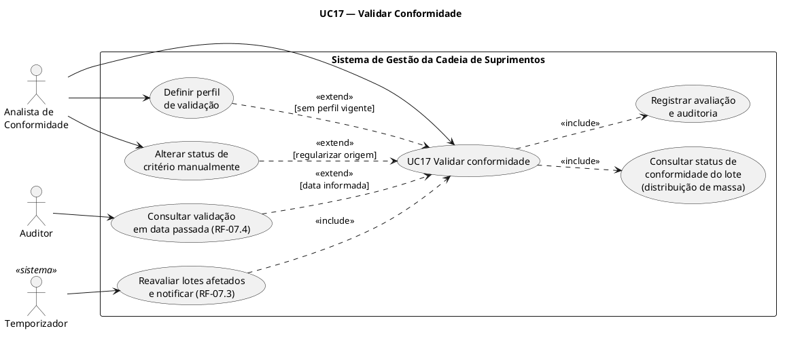

# UC17 — Validar Conformidade

| Campo | Valor |
|---|---|
| **Módulo** | Conformidade |
| **Ator principal** | Analista de Conformidade |
| **Atores secundários** | Sistema (worker), na reavaliação automática; Auditor, na consulta |
| **Estágio** | Piloto (consulta em data passada: Pós-piloto) |
| **Requisitos** | RF-06.1, RF-06.2, RF-07.2, RF-07.3, RF-07.4 |
| **Regras de negócio** | RN-05, RN-14, RN-16, RN-17, RN-18 |
| **Não funcionais** | RNF-03, RNF-07.1, RNF-10.1, RNF-21 |
| **Diagrama de casos de uso** | [`plantuml/uc17-validar-conformidade.puml`](plantuml/uc17-validar-conformidade.puml) |

## Objetivo

Decidir se um lote está **validado** ou **não validado** segundo o perfil de validação vigente da empresa, comparando, para cada critério ativo no perfil, a distribuição da massa do lote entre conforme, inconforme e não definido com a tolerância definida pelo usuário.

## Pré-condições

1. O usuário está autenticado e tem perfil Analista de Conformidade ou superior.
2. Existe um perfil de validação vigente com ao menos uma regra ativa (RF-06.1).
3. O lote existe, não foi baixado e tem participações de origem calculadas (RF-05.6).

## Pós-condições

**Sucesso**
1. Uma nova **avaliação do lote** está gravada com data, perfil e versão do perfil, resultado (validado ou não validado) e as regras que falharam (RF-06.2). Avaliações anteriores são preservadas.
2. O registro de auditoria foi gravado (RNF-10.1).
3. Se o resultado mudou em relação à avaliação anterior, um evento é emitido para atualizar painéis (RNF-21) e notificar os usuários.

**Falha**
- Nenhuma avaliação é gravada; a avaliação anterior continua sendo a vigente.

## Fluxo principal

1. O Analista abre o detalhe do lote e escolhe **Validar conformidade**.
2. O sistema obtém o perfil de validação vigente e suas regras ativas.
3. Para cada regra ativa, o sistema calcula a distribuição de massa do critério (RF-07.2):
   1. combina cada participação de origem do lote com o status **vigente** da origem para aquele critério, no nível de aplicação do critério (propriedade ou fornecedor, RN-17);
   2. soma as massas em conforme, inconforme e não definido; massa não definida nunca é tratada como conforme (RN-18); origens com status não aplicável ficam fora da distribuição.
4. Para cada regra, o sistema compara a parcela de massa inconforme e não definida com a tolerância máxima da regra (padrão 0%).
5. O sistema define o resultado: **validado** se todas as regras forem atendidas; **não validado** caso contrário, com a lista de regras que falharam.
6. O sistema grava a avaliação e o registro de auditoria.
7. O sistema exibe o resultado: para cada critério, a distribuição em kg e em %, a tolerância, se a regra foi atendida e, para as que falharam, as origens responsáveis pela massa inconforme ou não definida. O caso de uso termina.

## Fluxos alternativos

**A1 — Reavaliação automática** (início alternativo, RF-07.3)
1. Um status de critério de uma origem é registrado (consulta diária às fontes, RF-03.1, ou alteração manual, RF-07.5).
2. O worker consome o evento `StatusCriterioRegistrado` e identifica os lotes em estoque ou em trânsito que têm participação dessa origem.
3. Para cada lote, executa os passos 2 a 6 do fluxo principal.
4. Se o lote deixou de ser validado, notifica o Operador e o Analista (notificação na interface). O caso de uso termina.

**A2 — Consulta em data passada** (passo 1, Pós-piloto, RF-07.4)
1. O Analista ou o Auditor informa uma data passada.
2. O sistema executa os passos 2 a 5 usando o perfil vigente naquela data e o status de cada origem vigente naquela data (RN-16), sem gravar nova avaliação.
3. O sistema exibe o resultado marcado como "consulta histórica". O caso de uso termina.

**A3 — Regularizar e revalidar** (passo 7)
1. O Analista escolhe uma origem responsável por massa inconforme ou não definida.
2. O sistema inicia a alteração manual do status do critério, com justificativa e documento (RF-07.5, RN-08).
3. Ao concluir, volta ao passo 2.

## Fluxos de exceção

**E1 — Sem perfil de validação vigente** (passo 2)
- O sistema informa que não há perfil vigente e oferece o acesso à definição do perfil de validação (RF-06.1). O caso de uso termina sem gravar.

**E2 — Fonte externa indisponível** (passo 3)
- O sistema usa o último status obtido com sucesso e exibe a data dele ao lado do critério (RNF-07.1). A avaliação é gravada normalmente, com a data de cada status usado.

**E3 — Lote com origem não identificada** (passo 3)
- A massa sem origem entra como **não definida** em todos os critérios. O resultado tende a "não validado" e o sistema destaca a pendência de origem (RN-04).

## Regras e observações

- A decisão sempre se refere ao perfil: não existe agregação implícita entre critérios nem status único do lote.
- O cálculo usa a junção **participações × status vigente**, nunca o indicador agregado em cache das listas e painéis (RNF-21, ADR-003).
- A avaliação deve concluir em até 10 s (percentil 95) para lotes com até 5 níveis de mistura (RNF-03).
- Alterações no perfil de validação valem para lotes novos e em estoque e não alteram passaportes já gerados (RN-14).
