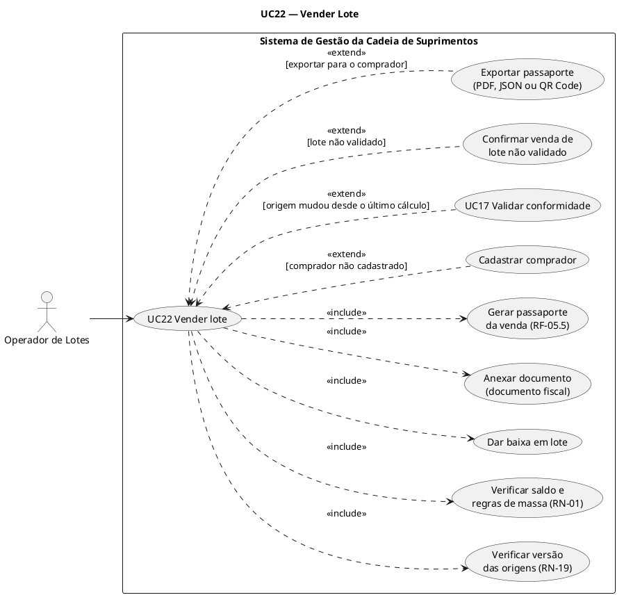

# UC22 — Vender Lote

| Campo | Valor |
|---|---|
| **Módulo** | Vendas |
| **Ator principal** | Operador de Lotes |
| **Atores secundários** | — (o comprador não interage com o sistema) |
| **Estágio** | Piloto |
| **Requisitos** | RF-13.1, RF-13.2, RF-05.4, RF-05.5, RF-06.2, RF-07.2, RF-12.1, RF-13.4 |
| **Regras de negócio** | RN-01, RN-04, RN-19, RN-20, RN-21 |
| **Não funcionais** | RNF-10.1, RNF-11, RNF-19, RNF-21, RNF-22 |
| **Diagrama de casos de uso** | [`plantuml/uc22-vender-lote.puml`](plantuml/uc22-vender-lote.puml) |

## Objetivo

Registrar a venda de um lote em estoque, total ou parcial, a um comprador, dando baixa na massa vendida e gerando o passaporte da venda, que comprova a origem e o status de conformidade do lote na data da venda.

## Pré-condições

1. O usuário está autenticado e tem perfil Operador de Lotes ou superior.
2. O lote está **em estoque** e tem saldo disponível.
3. O passaporte da etapa anterior do lote já foi gerado (RN-20).

## Pós-condições

**Sucesso**
1. A venda está gravada com comprador, data, massa (kg inteiros, RNF-19), documento fiscal e o resultado da validação do lote na data (RF-13.2, RF-13.4).
2. A massa vendida foi baixada do lote (RF-05.4); se o saldo chegou a zero, o lote passa a **baixado**.
3. O status de conformidade usado na venda foi calculado sobre a versão atual de cada origem (RN-19).
4. O evento `LoteMovimentado` e o registro de auditoria foram gravados na mesma transação (RNF-10.1, RNF-22); os indicadores dos painéis são atualizados em seguida (RNF-21).
5. O **passaporte da venda** é gerado com os status vigentes na data e o hash do passaporte anterior (RF-05.5, RN-21, RNF-11).

**Falha**
- Nada é gravado; o lote continua em estoque com o mesmo saldo.

## Fluxo principal

1. O Operador seleciona um lote em estoque e escolhe **Vender**.
2. O sistema exibe o saldo disponível, as origens, a distribuição de massa por critério e o resultado da última validação.
3. O Operador seleciona o comprador e informa a data da venda, a massa vendida e o número do documento fiscal.
4. O Operador anexa o documento fiscal (PDF ou imagem).
5. O Operador confirma.
6. O sistema verifica a **versão das origens**: compara a versão de status guardada em cada participação de origem com a versão atual da origem (RN-19). Todas coincidem.
7. O sistema verifica que a massa vendida não ultrapassa o saldo disponível do lote (RN-01).
8. O sistema grava, em uma única transação, a venda, a baixa da massa vendida, o novo saldo (e a situação **baixado**, se o saldo zerou), o documento, o resultado da validação usado, o evento `LoteMovimentado` e o registro de auditoria.
9. O sistema exibe a venda registrada e o passaporte com a indicação "em geração".
10. O sistema gera o passaporte da venda e atualiza a tela, com as opções de exportar em PDF, JSON ou QR Code. O caso de uso termina.

## Fluxos alternativos

**A1 — Comprador não cadastrado** (passo 3)
1. O Operador escolhe **Novo comprador**.
2. O sistema abre o cadastro de comprador (RF-13.1).
3. Ao concluir, o comprador fica selecionado; volta ao passo 3.

**A2 — Origem mudou desde o último cálculo** (passo 6)
1. O sistema identifica origens cuja versão atual difere da versão guardada na participação.
2. O sistema recalcula a distribuição de massa e revalida o lote ([UC17 — Validar Conformidade](uc17-validar-conformidade.md)), atualizando as versões nas participações.
3. Se o resultado da validação mudou, o sistema mostra o resultado anterior e o atual e pede nova confirmação ao Operador.
4. Volta ao passo 7.

**A3 — Lote não validado** (passo 2 ou A2)
1. O sistema alerta que o lote está **não validado** segundo o perfil vigente e mostra os critérios que falharam.
2. O Operador confirma que deseja vender mesmo assim.
3. O resultado "não validado" e os critérios que falharam ficam registrados na venda (RF-13.4). Segue para o passo 7.

**A4 — Venda parcial** (passo 8)
1. A massa vendida é menor que o saldo.
2. O lote continua **em estoque** com o saldo reduzido; as participações de origem do saldo mantêm a mesma distribuição percentual. Segue para o passo 9.

**A5 — Exportar passaporte para o comprador** (passo 10)
1. O Operador escolhe exportar o passaporte em PDF, JSON ou QR Code (RF-05.5).
2. O sistema gera o arquivo a partir do passaporte da venda, sem alterá-lo.

## Fluxos de exceção

**E1 — Massa maior que o saldo** (passo 7)
- O sistema recusa a venda, informa o saldo disponível em kg e volta ao passo 3 (RN-01).

**E2 — Lote bloqueado por origem não identificada** (passo 1)
- O sistema não permite a venda e informa a pendência de origem (RN-04).

**E3 — Passaporte da etapa anterior pendente** (passo 1)
- O sistema informa que o passaporte ainda está em geração e não permite vender até que ele exista (RN-20).

**E4 — Falha na gravação** (passo 8)
- A transação é desfeita, nada é gravado e o sistema mantém os dados para nova tentativa.

## Regras e observações

- A decisão sobre conformidade na venda nunca usa o indicador agregado das listas e painéis, que pode estar desatualizado (RN-19, RNF-21, ADR-003).
- O passaporte da venda é uma declaração pontual: não muda se o status de uma origem mudar depois da venda (RN-21).
- **Ponto em aberto:** a v3 não proíbe vender lote não validado (fluxo A3). Se a empresa quiser impedir, é preciso uma regra de negócio nova, por exemplo "a venda exige lote validado ou confirmação do Analista de Conformidade".
