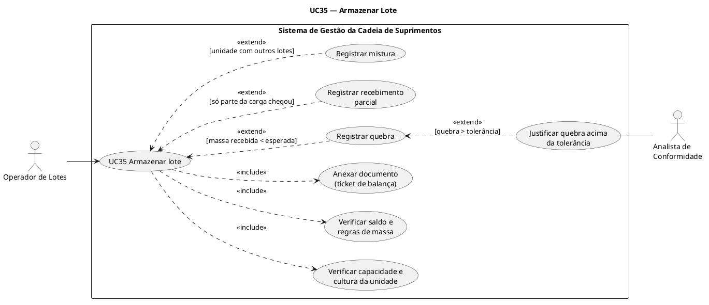

# UC35 — Armazenar Lote

| Campo | Valor |
|---|---|
| **Módulo** | Lotes e rastreabilidade |
| **Ator principal** | Operador de Lotes |
| **Atores secundários** | — |
| **Estágio** | Piloto |
| **Requisitos** | RF-05.2, RF-05.3, RF-05.5, RF-05.6, RF-05.9, RF-05.10, RF-12.1 |
| **Regras de negócio** | RN-01, RN-02, RN-04, RN-05, RN-20, RN-21, RN-23 |
| **Não funcionais** | RNF-10.1, RNF-19, RNF-21, RNF-22 |
| **Diagrama de casos de uso** | [`plantuml/uc35-armazenar-lote.puml`](plantuml/uc35-armazenar-lote.puml) |

## Objetivo

Registrar a chegada física de um lote em trânsito a uma unidade de armazenagem da empresa (armazém e silo, célula ou tanque), conferindo a massa e a qualidade recebidas, de modo que o lote passe a constar **em estoque**, no local correto, com o balanço de massa e a rastreabilidade preservados.

## Pré-condições

1. O usuário está autenticado e tem perfil Operador de Lotes ou superior.
2. O lote está **em trânsito** (registrado no UC07 ou transferido entre fornecedores, RF-05.8) ou é um lote de produto gerado no [UC36 — Transformar Lote](uc36-transformar-lote.md), que entra neste caso de uso a partir do passo 3, sem pesagem de chegada.
3. O passaporte da etapa anterior do lote já foi gerado (RN-20).
4. A unidade de armazenagem (armazém e silo, célula ou tanque) está cadastrada para a empresa (RF-05.9).

## Pós-condições

**Sucesso**
1. O lote está **em estoque**, associado à unidade de armazenagem, com a massa recebida e os parâmetros de qualidade medidos (RF-05.10).
2. A diferença entre massa esperada e recebida, se houver, está registrada como **quebra**, com o saldo e as participações de origem ajustados proporcionalmente (RN-01, RN-05).
3. O ticket de balança está anexado ao lote (RF-12.1).
4. O evento `LoteMovimentado` e o registro de auditoria foram gravados na mesma transação (RNF-22); os indicadores de estoque dos painéis são atualizados em seguida (RNF-21).

**Falha**
- O lote continua em trânsito; nada é gravado.

## Fluxo principal

1. O Operador abre a lista de lotes em trânsito, seleciona o lote e escolhe **Armazenar**.
2. O sistema exibe os dados esperados do lote: identificação, cultura, massa, origens, distribuição de massa por critério e resultado da última validação.
3. O Operador informa a unidade de armazenagem (armazém e silo, célula ou tanque), a data e hora da chegada, a massa recebida na pesagem e os parâmetros de qualidade medidos.
4. O Operador anexa o ticket de balança.
5. O Operador confirma.
6. O sistema valida o recebimento:
   1. a unidade aceita a cultura do lote e tem capacidade disponível para a massa recebida;
   2. a unidade está **vazia ou contém apenas este lote** (armazenagem segregada);
   3. a massa recebida não é maior que a esperada, e a quebra está dentro da tolerância configurada pela empresa para a cultura.
7. Se houver quebra, o sistema a registra como saída do lote, reduzindo a massa e as participações de origem na mesma proporção, sem alterar a distribuição percentual entre os status (RN-01, RN-05).
8. O sistema grava, em uma única transação, a situação **em estoque**, a unidade, a massa recebida, os parâmetros de qualidade, a quebra, o documento, o evento `LoteMovimentado` e o registro de auditoria.
9. O sistema exibe o lote em estoque, com a localização, a massa e a quebra registradas. O caso de uso termina.

## Fluxos alternativos

**A1 — Unidade já contém outros lotes (armazenagem com mistura)** (passo 6.2)
1. O sistema informa que armazenar na unidade mistura o lote com os grãos já existentes e mostra como ficaria a distribuição de massa por critério da mistura e se ela continuaria validada.
2. O Operador confirma a mistura.
3. O sistema registra o recebimento (passos 7 e 8) e, na mesma operação, uma **mistura** (RF-05.2) que gera um novo lote para o conteúdo da unidade, com as participações de origem combinadas pelas massas (RF-05.2, RF-05.6). Massa inconforme ou não definida não se torna conforme pela mistura (RN-05).
4. O sistema gera o passaporte da mistura, com os hashes dos passaportes de entrada (RF-05.5). O caso de uso termina.

**A2 — Recebimento parcial** (passo 3)
1. O Operador informa que só parte da carga chegou.
2. O sistema registra a parte recebida em estoque e mantém o restante em trânsito, como lote derivado com as mesmas participações proporcionais. Segue para o passo 4.

## Fluxos de exceção

**E1 — Massa recebida maior que a esperada** (passo 6.3, RN-23)
- O sistema recusa o recebimento, porque a massa a mais não teria origem (RN-01, RN-04). Orienta a corrigir a pesagem ou a registrar a massa excedente como novo lote de entrada (UC07).

**E2 — Quebra acima da tolerância** (passo 6.3, RN-23)
- O sistema exige justificativa e permite concluir. O recebimento fica sinalizado para conferência pelo Analista e é registrado na auditoria.

**E3 — Unidade sem capacidade ou com cultura incompatível** (passo 6.1)
- O sistema informa a capacidade disponível e as culturas aceitas e volta ao passo 3.

**E4 — Passaporte da etapa anterior pendente** (pré-condição 3)
- O sistema informa que o passaporte ainda está em geração e não permite armazenar até que ele exista (RN-20).

**E5 — Lote bloqueado por origem não identificada**
- O sistema permite armazenar, mas mantém o bloqueio para saída e exibe o alerta da pendência (RN-04).

## Requisitos incluídos na v3

Este caso de uso originou, na v3, os requisitos RF-05.9 (unidades de armazenagem) e RF-05.10 (recebimento de lote), a regra RN-23 (quebra no recebimento), os termos de glossário **Unidade de armazenagem** e **Quebra**, e as classes **UnidadeArmazenagem** e **Recebimento** do diagrama de domínio.
