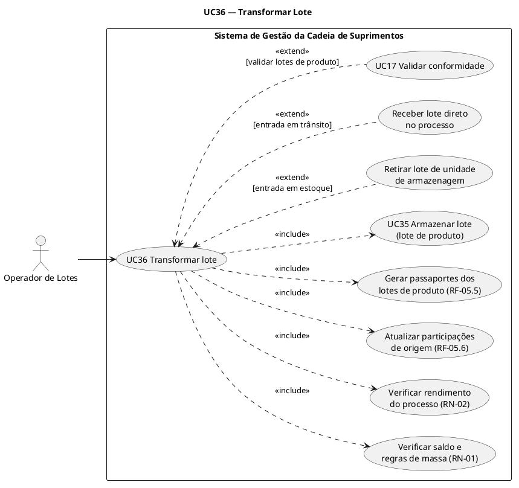

# UC36 — Transformar Lote

| Campo | Valor |
|---|---|
| **Módulo** | Lotes e rastreabilidade ([diagrama](../diagrams/casos-de-uso.md#2-lotes-e-rastreabilidade)) |
| **Ator principal** | Operador de Lotes |
| **Atores secundários** | — |
| **Estágio** | Piloto |
| **Requisitos** | RF-05.2, RF-05.3, RF-05.5, RF-05.6, RF-05.9, RF-05.10, RF-05.11, RF-06.2 |
| **Regras de negócio** | RN-01, RN-02, RN-03, RN-04, RN-05, RN-18, RN-20, RN-21, RN-23 |
| **Não funcionais** | RNF-10.1, RNF-11, RNF-19, RNF-21, RNF-22 |
| **Diagrama de casos de uso** | [`plantuml/uc36-transformar-lote.puml`](plantuml/uc36-transformar-lote.puml) |

## Objetivo

Registrar a transformação industrial de um ou mais lotes (por exemplo, esmagamento de soja em farelo, óleo e casca), consumindo os lotes de entrada e gerando **lotes de produto** diferentes, que são armazenados em novas unidades de armazenagem. A rastreabilidade e o status de conformidade dos produtos são herdados das entradas por balanço de massa.

Cada lote de entrada pode chegar ao processo de duas formas:

- **retirado de um armazém**, quando está em estoque em uma unidade de armazenagem (fluxo principal);
- **recebido e enviado direto ao processo**, quando chega em trânsito e não passa por armazenagem (fluxo A1).

## Pré-condições

1. O usuário está autenticado e tem perfil Operador de Lotes ou superior.
2. O tipo de processo está cadastrado, com os produtos de saída e a faixa de rendimento permitida (RN-02, RF-05.11).
3. Os lotes de entrada estão em estoque ou em trânsito, não estão bloqueados por origem não identificada (RN-04) e já têm o passaporte da etapa anterior (RN-20).
4. As unidades de armazenagem de destino estão cadastradas e aceitam os produtos de saída (RF-05.9).

## Pós-condições

**Sucesso**
1. O processo de transformação está gravado com tipo, data, lotes e massas de entrada, lotes e massas de saída, rendimento declarado e perda de processo (RF-05.2).
2. A massa consumida foi baixada de cada lote de entrada; os que ficaram com saldo zero passam a **baixado** (RF-05.3, RN-01).
3. Cada lote de produto está **em estoque** na unidade de destino, com participações de origem herdadas das entradas (RF-05.6, RN-05).
4. O evento `LoteMovimentado` e o registro de auditoria foram gravados na mesma transação (RNF-10.1, RNF-22).
5. Um passaporte foi gerado para cada lote de produto, com os hashes dos passaportes de todas as entradas (RF-05.5, RNF-11).

**Falha**
- Nada é gravado: entradas, saídas e unidades continuam como antes.

## Fluxo principal

1. O Operador escolhe **Nova transformação**.
2. O sistema exibe os tipos de processo da empresa, com os produtos de saída e a faixa de rendimento de cada um.
3. O Operador seleciona o tipo de processo e informa a data.
4. O Operador seleciona um lote de entrada **em estoque**, a unidade de armazenagem de onde ele será retirado e a massa retirada.
5. O sistema verifica que o lote tem passaporte (RN-20), não está bloqueado (RN-04), é de cultura ou produto aceito pelo processo e que a massa retirada não ultrapassa o saldo (RN-01).
6. O Operador repete os passos 4 e 5 para cada lote de entrada.
7. O Operador informa os **lotes de produto** de saída: produto, identificação e massa de cada um. O sistema calcula o rendimento declarado e a perda de processo.
8. O sistema verifica que a soma das massas de saída não ultrapassa a massa de entrada multiplicada pelo rendimento e que o rendimento está dentro da faixa do tipo de processo (RN-02).
9. Para cada lote de produto, o Operador informa a unidade de armazenagem de destino, e o sistema verifica capacidade e produto aceito ([UC35 — Armazenar Lote](uc35-armazenar-lote.md), passos 3 a 6).
10. O sistema calcula as participações de origem de cada lote de produto: soma as participações das entradas, ponderadas pela massa consumida de cada uma, e as escala para a massa do produto. A distribuição percentual entre conforme, inconforme e não definido é a mesma das entradas, e massa inconforme ou não definida não se torna conforme (RN-05, RN-18).
11. O sistema grava, em uma única transação, o processo, as retiradas e baixas das entradas, os lotes de produto em estoque nas unidades de destino, as participações, a perda, o evento `LoteMovimentado` e o registro de auditoria.
12. O sistema gera um passaporte para cada lote de produto, com os hashes dos passaportes de entrada (RF-05.5).
13. O sistema exibe o processo: entradas, saídas, rendimento, perda e a distribuição de massa por critério de cada lote de produto. O caso de uso termina.

## Fluxos alternativos

**A1 — Lote recebido e enviado direto ao processo** (passo 4)
1. O Operador seleciona um lote **em trânsito** e informa a data de chegada, a massa recebida na pesagem e o ticket de balança.
2. O sistema registra o recebimento sem associar o lote a uma unidade de armazenagem, aplicando as mesmas regras de quebra do [UC35](uc35-armazenar-lote.md) (passos 6.3 e 7, E1 e E2; RF-05.10, RN-23).
3. A massa recebida passa a ser a massa disponível para o processo. Segue para o passo 5.

**A2 — Retirada parcial** (passo 4)
1. A massa retirada é menor que o saldo do lote.
2. O lote continua em estoque na unidade de origem com o saldo reduzido, mantendo a mesma distribuição percentual entre os status. Segue para o passo 5.

**A3 — Várias entradas de origens diferentes** (passo 6)
1. Os lotes de entrada têm origens e status diferentes.
2. As participações dos produtos combinam as de todas as entradas na proporção das massas consumidas, como em uma mistura (RN-05). O sistema mostra, antes de confirmar, a distribuição por critério resultante e se os produtos ficariam validados.

**A4 — Unidade de destino já contém o mesmo produto** (passo 9)
1. O sistema informa que armazenar o lote de produto na unidade o mistura com o conteúdo existente.
2. O Operador confirma, e o sistema registra também a mistura (UC08), como no fluxo A1 do UC35.

**A5 — Validar os lotes de produto** (passo 13)
1. O Operador ou o Analista escolhe validar um lote de produto.
2. O sistema executa o [UC17 — Validar Conformidade](uc17-validar-conformidade.md) para esse lote.

## Fluxos de exceção

**E1 — Rendimento fora da faixa do tipo de processo** (passo 8)
- O sistema recusa a transformação, mostra o rendimento calculado e a faixa permitida e volta ao passo 7 (RN-02).

**E2 — Saídas maiores que entrada × rendimento** (passo 8)
- O sistema mostra o excesso em kg e volta ao passo 7 (RN-02).

**E3 — Massa retirada maior que o saldo** (passo 5)
- O sistema informa o saldo disponível e volta ao passo 4 (RN-01).

**E4 — Lote de entrada bloqueado ou sem passaporte** (passo 5)
- O sistema não aceita o lote como entrada e informa o motivo: origem não identificada (RN-04) ou passaporte em geração (RN-20).

**E5 — Unidade de destino sem capacidade ou incompatível** (passo 9)
- O sistema informa a capacidade disponível e os produtos aceitos e volta ao passo 9.

**E6 — Falha na gravação** (passo 11)
- A transação é desfeita, nada é gravado e o sistema mantém os dados para nova tentativa.

## Regras e observações

- O grafo de lotes continua acíclico: um lote de produto nunca pode ser entrada, direta ou indireta, do processo que o gerou (RN-03).
- Os critérios continuam sendo avaliados nas origens (propriedades e fornecedores); o produto só herda a participação de cada origem, nunca um status próprio (ADR-003).
- A perda de processo (água, impurezas) reduz a massa total, mas não altera a distribuição percentual entre os status.

## Requisitos incluídos na v3

Este caso de uso originou, na v3, o requisito RF-05.11 (produtos e tipos de processo), os termos de glossário **Produto** e **Perda de processo**, e a classe **Produto** do diagrama de domínio, associada a Lote, UnidadeArmazenagem e TipoProcesso. Usa também RF-05.9 e RF-05.10, originados no [UC35](uc35-armazenar-lote.md).
