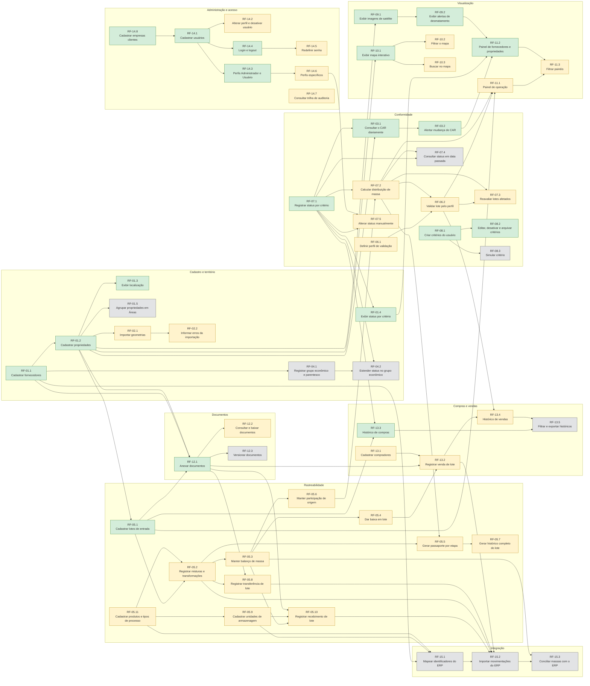

# Documento de Especificação de Requisitos

_Análise e Projeto de Sistemas_

| Campo | Valor |
|---|---|
| Projeto / Sistema | Gestão de Cadeia de Suprimentos |
| Cliente / Solicitante | [a definir] |
| Responsável(is) | Pedro Henrique Carteli Rossetto |
| Data | 25/11/2026 |
| Versão | 3.0 |

## 1. Introdução

### 1.1 Sobre este documento

Este documento apresenta e organiza o conjunto completo de requisitos levantados para o sistema de gestão da cadeia de suprimentos, servindo de referência para as etapas de projeto, desenvolvimento, testes e validação.

IDs com ponto (ex.: RF-08.1) são subitens de um requisito dividido para manter cada item atômico; uma referência a RF-02 vale para todos os RF-02.x.

A prioridade indica o estágio de entrega: Demo (apresentação de demonstração ao cliente), Piloto (MVP em operação com o primeiro cliente) e Pós-piloto (evolução após o piloto). Um requisito nunca depende de outro de estágio posterior.

As decisões de arquitetura que motivaram requisitos desta versão estão em docs/adr/ (ADR-001 a ADR-007). O Apêndice C lista as alterações em relação à versão 2.0.

### 1.2 Descrição do Mini-Mundo

O sistema atua na cadeia de suprimentos de grãos: produtores rurais (fornecedores) entregam a produção de suas propriedades a armazéns, tradings e indústrias, que a agrupam em lotes, misturam e transformam antes de entregá-la a compradores.

Compradores e a regulação socioambiental exigem comprovar que os grãos não vêm de propriedades com desmatamento.

Uma mesma instalação do sistema atende várias empresas clientes (armazéns, tradings e indústrias), com os dados de cada uma isolados das demais. Dados públicos de referência (listas de embargo, lista suja e SICAR) são compartilhados entre as empresas.

Empresas que já usam um ERP para estoque, balança, produção e faturamento podem importar dele essas movimentações; o sistema é a referência para a origem, a conformidade e os passaportes dos lotes (ADR-008).

Atores: Administrador, Analista de Conformidade, Operador de Lotes e Auditor (somente leitura). No estágio Demo, os perfis são simplificados a Administrador e Usuário (RF-14.3).

Entidades principais: empresa, fornecedor, propriedade, lote, mistura e transformação, participação de origem, passaporte digital, critério de conformidade, status de conformidade, perfil de validação, unidade de armazenagem, produto, comprador e venda.

### 1.3 Propósito do Sistema

Rastrear os grãos desde as propriedades de origem até o destino final, avaliar a conformidade socioambiental de fornecedores, propriedades e lotes por critério e por balanço de massa, registrar cada etapa em passaporte digital, com trilha de auditoria. Espera-se reduzir o esforço manual de verificação e permitir comprovar a origem de cada lote.

### 1.4 Glossário

- **Produtor / fornecedor** — Pessoa física ou jurídica (CPF/CNPJ) que fornece grãos. No sistema, "fornecedor" é o cadastro do produtor.
- **Propriedade** — Imóvel rural de um fornecedor, com localização e geometria.
- **Região** — Divisão administrativa (município ou UF) derivada da localização da propriedade.
- **Área** — Agrupamento de propriedades definido pelo usuário (RF-01.5).
- **Critério de conformidade** — Verificação do catálogo, composta por nome, nível de aplicação (propriedade ou fornecedor), tipo de avaliação com seus parâmetros, fonte de dados, indicação de se é bloqueante e se é eliminatório, e versão. Pode ser do sistema (protegido, só a equipe técnica altera) ou do usuário (criado e editado por Analista de Conformidade ou superior). Cada critério é avaliado de forma independente dos demais.
- **Tipo de avaliação** — Modelo de regra oferecido pelo sistema, parametrizável sem programação: consulta em lista por chave (CPF/CNPJ ou geometria), mapa de valores de um campo (ex.: situação do CAR), limiar numérico sobre um campo cadastral e sobreposição geométrica com uma camada. Um critério é uma instância de um tipo, com seus parâmetros.
- **Status de conformidade (propriedade ou fornecedor)** — Resultado da avaliação de um critério sobre a entidade: conforme, inconforme, não definido (sem avaliação ou sem dado) ou não aplicável (o critério não se aplica à entidade). Cada status guarda a data de avaliação. Não existe status único da entidade, apenas um status por critério.
- **Status de conformidade (lote)** — Para cada critério, a distribuição da massa do lote entre conforme, inconforme e não definido. É derivada das participações de origem do lote e do status vigente de cada origem, cada critério considerado no seu nível de aplicação; o status não é copiado para o lote. Muda quando o status de uma origem muda e pode ser consultado para uma data passada.
- **Perfil de validação** — Conjunto de regras definido pelo usuário (RF-06.1); cada regra indica um critério do catálogo e a tolerância máxima de massa inconforme e não definida (padrão: 0%). Não existe agregação implícita entre critérios: a decisão sim/não sempre se refere ao perfil.
- **Lote validado** — Lote que atende todas as regras do perfil de validação vigente na data da avaliação (RF-06.2) e cujas origens não tiveram status alterado desde então (versão de origem).
- **Empresa** — Cliente do sistema (armazém, trading ou indústria). Cada usuário pertence a uma única empresa, e os dados de uma empresa não são visíveis às demais.
- **Participação de origem** — Parcela da massa de um lote, em kg, atribuída a uma propriedade e ao seu fornecedor de origem. É calculada por balanço de massa a cada movimentação do lote, levando misturas e transformações até as propriedades de origem.
- **Versão de origem** — Contador de uma propriedade ou fornecedor, incrementado a cada mudança de status em qualquer critério. Cada participação de origem guarda a versão usada no seu último cálculo.
- **Etapa** — Evento que cria ou modifica um lote: cadastro de entrada, mistura, transformação, transferência ou venda.
- **Passaporte digital** — Registro imutável de uma etapa de um lote, com os dados da etapa, os status de conformidade vigentes na data e o hash dos passaportes dos lotes de entrada. O encadeamento dos passaportes reconstitui o histórico completo do lote.
- **Dado de referência** — Dado público de fonte externa (listas de embargo, lista suja, SICAR), compartilhado entre as empresas e versionado por período de vigência.
- **Unidade de armazenagem** — Local físico de uma empresa onde lotes ficam em estoque: um armazém e suas divisões (silos, células ou tanques), com capacidade em kg e produtos aceitos (RF-05.9).
- **Produto** — O que um lote contém. Pode ser uma cultura (grão como sai da propriedade, ex.: soja) ou um derivado gerado por transformação (ex.: farelo e óleo de soja) (RF-05.11).
- **Quebra** — Diferença entre a massa esperada de um lote em trânsito e a massa recebida na pesagem de chegada. É registrada como saída do lote e não altera a distribuição percentual entre os status (RF-05.10, RN-23).
- **Perda de processo** — Diferença entre a massa de entrada de uma transformação e a soma das massas dos lotes de produto gerados (água, impurezas), limitada pelo rendimento do tipo de processo (RN-02).
- **Conciliação de massas** — Comparação periódica entre os saldos de lotes e unidades de armazenagem registrados no ERP da empresa e no sistema, com a lista das divergências encontradas (RF-15.3).

## 2. Requisitos Funcionais

O que o sistema deve fazer — as funcionalidades que ele deve oferecer.

| ID | Descrição | Categoria | Estágio | Depende de |
|---|---|---|---|---|
| RF-01.1 | O sistema deve permitir cadastrar fornecedores com nome, CPF/CNPJ e contato. | Cadastro e território | Demo | — |
| RF-01.2 | O sistema deve permitir cadastrar, para cada fornecedor, uma ou mais propriedades com nome, município/UF, área em hectares, cultura e localização geográfica (ponto ou polígono). | Cadastro e território | Demo | RF-01.1 |
| RF-01.3 | O sistema deve exibir a localização cadastrada nas telas de detalhe de fornecedor e de propriedade. | Cadastro e território | Demo | RF-01.2 |
| RF-01.4 | O sistema deve exibir, nas telas de detalhe de fornecedor e de propriedade, o status de cada critério aplicável (conforme, inconforme, não definido ou não aplicável), com a data de avaliação e a fonte. | Cadastro e território | Demo | RF-07.1 |
| RF-01.5 | O sistema deve permitir ao usuário criar Áreas e associar propriedades a elas. | Cadastro e território | Pós-piloto | RF-01.2 |
| RF-02.1 | O sistema deve importar a geometria de propriedades a partir de arquivos .shp, .geojson e .kml. | Cadastro e território | Piloto | RF-01.2 |
| RF-02.2 | O sistema deve informar ao usuário, para cada arquivo importado, os erros encontrados (feição e motivo). | Cadastro e território | Piloto | RF-02.1 |
| RF-03.1 | O sistema deve consultar a situação do CAR de cada propriedade na base do SICAR ao menos uma vez por dia e registrar o status do critério Situação do CAR (RN-10). | Conformidade | Demo | RF-01.2, RF-07.1 |
| RF-03.2 | O sistema deve alertar o usuário (notificação na interface) quando a situação do CAR de uma propriedade mudar. | Conformidade | Demo | RF-03.1 |
| RF-04.1 | O sistema deve permitir registrar vínculos de grupo econômico e de parentesco entre fornecedores (CPF/CNPJ). | Cadastro e território | Pós-piloto | RF-01.1 |
| RF-04.2 | O sistema deve estender o status de cada critério entre os integrantes de um grupo econômico, conforme RN-07. | Cadastro e território | Pós-piloto | RF-04.1, RF-07.1 |
| RF-05.1 | O sistema deve permitir cadastrar lotes de entrada com identificação, massa, cultura, data e propriedade(s) de origem, além de parâmetros de qualidade configuráveis pelo usuário. | Rastreabilidade | Demo | RF-01.2 |
| RF-05.2 | O sistema deve permitir registrar misturas e transformações de lotes, com lotes de entrada, massas, tipo de processo, rendimento declarado e lotes de produto de saída, mantendo o fluxo de lotes como Grafo Acíclico Direcionado (DAG) que liga fornecedores, lotes, misturas e transformações. | Rastreabilidade | Piloto | RF-05.1, RF-05.11 |
| RF-05.3 | O sistema deve manter o balanço de massa de cada lote, calculando seu saldo disponível a cada entrada, saída ou baixa. | Rastreabilidade | Piloto | RF-05.2 |
| RF-05.4 | O sistema deve permitir dar baixa em um lote ao chegar ao destino final. | Rastreabilidade | Piloto | RF-05.3 |
| RF-05.5 | O sistema deve gerar, a cada etapa do lote (cadastro de entrada, mistura, transformação, transferência e venda), um passaporte digital imutável com os dados da etapa, os status de conformidade vigentes na data e a referência aos passaportes dos lotes de entrada, exibível na tela e exportável em PDF, JSON ou QR Code. | Rastreabilidade | Piloto | RF-05.2, RF-07.2 |
| RF-05.6 | O sistema deve manter, para cada lote, a participação em massa de cada propriedade e fornecedor de origem, recalculada a cada movimentação do lote. | Rastreabilidade | Piloto | RF-05.3 |
| RF-05.7 | O sistema deve gerar sob demanda o histórico completo de um lote, das propriedades de origem até a etapa consultada, a partir dos passaportes encadeados, exportável em PDF ou JSON. | Rastreabilidade | Piloto | RF-05.5 |
| RF-05.8 | O sistema deve permitir registrar a transferência de um lote entre fornecedores, com data, massa e documento fiscal. | Rastreabilidade | Piloto | RF-05.2, RF-12.1 |
| RF-05.9 | O sistema deve permitir cadastrar unidades de armazenagem da empresa (armazém e silos, células ou tanques), com capacidade em kg e produtos aceitos, e exibir o saldo ocupado de cada uma. | Rastreabilidade | Piloto | RF-05.11 |
| RF-05.10 | O sistema deve permitir registrar o recebimento de um lote em trânsito, com data, massa recebida, parâmetros de qualidade e ticket de balança, armazenando-o em uma unidade de armazenagem ou enviando-o direto a um processo de transformação, e registrando a quebra quando houver. | Rastreabilidade | Piloto | RF-05.3, RF-05.9, RF-12.1 |
| RF-05.11 | O sistema deve permitir cadastrar produtos (culturas e derivados) e tipos de processo, com os produtos de entrada aceitos, os produtos de saída e a faixa de rendimento permitida. | Rastreabilidade | Piloto | — |
| RF-06.1 | O sistema deve permitir ao usuário definir o perfil de validação: para cada critério do catálogo, ativá-lo e informar a tolerância máxima de massa inconforme e não definida (padrão 0%). | Conformidade | Piloto | — |
| RF-06.2 | O sistema deve avaliar cada lote comparando a distribuição de massa de cada critério (RF-07.2) com o perfil de validação, e registrar o resultado "validado" ou "não validado" com os critérios que falharam. | Conformidade | Piloto | RF-06.1, RF-07.2 |
| RF-07.1 | O sistema deve registrar, para cada propriedade e fornecedor, o status de cada critério aplicável, com data de avaliação, fonte e versão do critério. | Conformidade | Demo | — |
| RF-07.2 | O sistema deve calcular, para cada lote e cada critério, a distribuição da massa entre conforme, inconforme e não definido, combinando as participações de origem do lote com o status vigente de cada origem. | Conformidade | Piloto | RF-05.6, RF-07.1 |
| RF-07.3 | O sistema deve reavaliar a validação dos lotes afetados, em estoque ou em trânsito, e notificar o usuário dos lotes que deixaram de ser validados quando o status de um critério de uma origem mudar. | Conformidade | Piloto | RF-06.2, RF-07.2 |
| RF-07.4 | O sistema deve permitir consultar o status de propriedades, fornecedores e lotes em uma data passada. | Conformidade | Pós-piloto | RF-07.1, RF-07.2 |
| RF-07.5 | O sistema deve permitir alterar manualmente o status de um critério de uma propriedade ou fornecedor, conforme RN-08. | Conformidade | Piloto | RF-07.1, RF-14.6 |
| RF-08.1 | O sistema deve permitir criar critérios do usuário a partir de um tipo de avaliação, preenchendo os atributos do critério (ver Glossário). | Conformidade | Demo | — |
| RF-08.2 | O sistema deve permitir editar, desativar e arquivar critérios do usuário. | Conformidade | Demo | RF-08.1 |
| RF-08.3 | O sistema deve permitir simular um critério do usuário sobre as entidades existentes antes de publicá-lo. | Conformidade | Pós-piloto | RF-08.1 |
| RF-09.1 | O sistema deve exibir imagens de satélite de propriedades, obtidas via API de ao menos duas fontes de satélite selecionáveis pelo usuário. | Visualização | Demo | RF-01.2 |
| RF-09.2 | O sistema deve exibir sobre a imagem da propriedade os alertas de desmatamento obtidos via API. | Visualização | Demo | RF-09.1 |
| RF-10.1 | O sistema deve exibir fornecedores, propriedades e lotes em trânsito em mapa interativo. | Visualização | Demo | RF-01.2 |
| RF-10.2 | O mapa deve permitir filtrar por status de um critério selecionado, cultura e UF. | Visualização | Piloto | RF-10.1 |
| RF-10.3 | O mapa deve permitir buscar por nome de município ou por coordenadas. | Visualização | Piloto | RF-10.1 |
| RF-11.1 | O sistema deve exibir um painel (dashboard) de operação com a quantidade e a massa de lotes em estoque e em trânsito, a massa por status de conformidade (conforme, inconforme, não definido) de um critério selecionado e a quantidade de lotes validados e não validados. | Visualização | Piloto | RF-05.1, RF-06.2, RF-07.2 |
| RF-11.2 | O sistema deve exibir um painel (dashboard) de fornecedores e propriedades com a quantidade por status de um critério selecionado, por cultura e por UF, e os alertas recentes de CAR e de desmatamento. | Visualização | Demo | RF-01.4, RF-03.2, RF-09.2 |
| RF-11.3 | Os painéis devem permitir filtrar por período, cultura, UF, fornecedor e critério. | Visualização | Piloto | RF-11.1, RF-11.2 |
| RF-12.1 | O sistema deve permitir anexar documentos (PDF ou imagem) a fornecedores, propriedades, lotes e transferências, informando o tipo do documento e registrando a data e o usuário do envio. | Documentos | Demo | RF-01.1, RF-01.2, RF-05.1 |
| RF-12.2 | O sistema deve permitir consultar, filtrar por tipo, entidade e período, e baixar os documentos anexados. | Documentos | Piloto | RF-12.1 |
| RF-12.3 | O sistema deve manter as versões de um documento: a substituição gera uma nova versão e preserva as anteriores. | Documentos | Pós-piloto | RF-12.1 |
| RF-13.1 | O sistema deve permitir cadastrar compradores com nome, CPF/CNPJ e contato. | Compras e vendas | Piloto | — |
| RF-13.2 | O sistema deve permitir registrar a venda de um lote a um comprador, com data, massa e documento fiscal. | Compras e vendas | Piloto | RF-05.4, RF-12.1, RF-13.1 |
| RF-13.3 | O sistema deve exibir, no detalhe de cada fornecedor, o histórico de compras (lotes recebidos) com data, cultura, massa, propriedade de origem e o status de cada critério na data do recebimento. | Compras e vendas | Demo | RF-05.1, RF-07.1 |
| RF-13.4 | O sistema deve exibir, no detalhe de cada comprador, o histórico de vendas com os lotes entregues, data, massa, resultado da validação e os critérios atendidos. | Compras e vendas | Piloto | RF-06.2, RF-13.2 |
| RF-13.5 | O sistema deve permitir filtrar os históricos de compras e de vendas por período e cultura e exportá-los em CSV. | Compras e vendas | Pós-piloto | RF-13.3, RF-13.4 |
| RF-14.1 | O sistema deve permitir ao Administrador cadastrar usuários da sua empresa com nome, e-mail e perfil. | Administração e acesso | Demo | RF-14.8 |
| RF-14.2 | O sistema deve permitir ao Administrador alterar o perfil de um usuário e desativá-lo, preservando os registros de auditoria associados a ele. | Administração e acesso | Piloto | RF-14.1 |
| RF-14.3 | O sistema deve oferecer dois perfis: Administrador, com acesso a todas as funcionalidades e à gestão de usuários, e Usuário, com acesso às demais funcionalidades, sem gerenciar usuários. | Administração e acesso | Demo | RF-14.1 |
| RF-14.4 | O sistema deve exigir login com e-mail e senha para acesso a qualquer funcionalidade e permitir encerrar a sessão. | Administração e acesso | Demo | RF-14.1 |
| RF-14.5 | O sistema deve permitir ao usuário redefinir a senha por link enviado ao e-mail cadastrado. | Administração e acesso | Piloto | RF-14.4 |
| RF-14.6 | O sistema deve substituir o perfil Usuário por perfis específicos: Auditor apenas consulta; Operador de Lotes cadastra fornecedores, propriedades, lotes e documentos; Analista de Conformidade também gerencia critérios do usuário, perfil de validação e alterações manuais de status. | Administração e acesso | Piloto | RF-14.3 |
| RF-14.7 | O sistema deve permitir ao Administrador e ao Auditor consultar a trilha de auditoria, filtrando por usuário, entidade, ação e período. | Administração e acesso | Piloto | RNF-10.1 |
| RF-14.8 | O sistema deve permitir à equipe técnica cadastrar empresas clientes e o primeiro Administrador de cada uma. | Administração e acesso | Demo | — |
| RF-15.1 | O sistema deve permitir mapear os identificadores do ERP da empresa (fornecedores, produtos, unidades de armazenagem e lotes) para os cadastros do sistema. | Integração | Pós-piloto | RF-01.1, RF-05.9, RF-05.11 |
| RF-15.2 | O sistema deve importar do ERP, via API ou arquivo CSV, recebimentos, transformações, transferências e vendas, registrando-os como as movimentações equivalentes do sistema. | Integração | Pós-piloto | RF-15.1, RF-05.10, RF-05.2, RF-05.8, RF-13.2, RNF-13, RNF-14 |
| RF-15.3 | O sistema deve conciliar, sob demanda e periodicamente, os saldos de lotes e unidades de armazenagem com os do ERP e listar as divergências em kg. | Integração | Pós-piloto | RF-15.2, RF-05.3 |

## 3. Requisitos Não Funcionais

Restrições e condições de qualidade sobre os requisitos funcionais — desempenho, segurança, usabilidade, confiabilidade, interface, entre outras.

| ID | Descrição | Categoria | Estágio | Depende de |
|---|---|---|---|---|
| RNF-01 | A visão inicial do mapa deve carregar em até 3 s (percentil 95) com 10.000 propriedades na base. | Desempenho | Piloto | RF-10.1 |
| RNF-02 | Filtros e buscas do mapa devem responder em até 2 s (percentil 95) com 10.000 propriedades na base. | Desempenho | Piloto | RF-10.2, RF-10.3 |
| RNF-03 | A avaliação de RF-06.2 de um lote deve concluir em até 10 s (percentil 95) para lotes com até 5 níveis de mistura. | Desempenho | Piloto | RF-06.2 |
| RNF-04 | O sistema deve suportar 50.000 fornecedores, 200.000 propriedades e 5 milhões de lotes, mantendo as metas de RNF-01, RNF-02 e RNF-03. | Escalabilidade | Pós-piloto | — |
| RNF-05 | O sistema deve ter disponibilidade mensal de 99,5%, excluídas janelas de manutenção comunicadas com antecedência. | Confiabilidade | Pós-piloto | — |
| RNF-06 | O sistema deve executar backup automático diário, retido por 30 dias. | Confiabilidade | Piloto | — |
| RNF-07.1 | Se uma API externa (satélite, Ibama, ICMBio, lista suja, SICAR) estiver indisponível, o sistema deve usar a última resposta obtida com sucesso e exibir a data dela. | Confiabilidade | Piloto | RF-09.1, RF-03.1 |
| RNF-07.2 | Após falha de consulta a API externa, o sistema deve repetir a consulta com intervalo crescente (backoff exponencial iniciando em 1 min, dobrando a cada tentativa, até o máximo de 1 h). | Confiabilidade | Piloto | RNF-07.1 |
| RNF-08 | Senhas devem ser armazenadas apenas como hash com salt (bcrypt ou Argon2). | Segurança | Demo | RF-14.4 |
| RNF-09 | O sistema deve oferecer autenticação em dois fatores | Segurança | Pós-piloto | RF-14.4, RNF-08 |
| RNF-10.1 | O sistema deve registrar em trilha de auditoria (usuário, data/hora, ação, valor anterior e novo) a criação, alteração e exclusão de fornecedores, propriedades, lotes, critérios, perfis de validação, documentos e usuários, e as alterações manuais de status. | Segurança | Piloto | — |
| RNF-10.2 | A trilha de auditoria deve ser append-only: nenhum perfil, inclusive Administrador, pode editar ou excluir registros. | Segurança | Piloto | RNF-10.1 |
| RNF-11 | Passaportes devem ter hash calculado sobre JSON canônico (RFC 8785), incluindo o hash dos passaportes de entrada, de modo que qualquer alteração posterior seja detectável. Alterações por anonimização (RS-03) geram novo hash, registrado na trilha. | Integridade | Piloto | RF-05.5 |
| RNF-12 | Todo dado importado de fonte externa deve guardar fonte, data de obtenção e versão, para reproduzir a análise feita em qualquer data passada. | Integridade | Piloto | RF-02.1 |
| RNF-13 | O sistema deve expor API REST documentada em OpenAPI, usada também pela interface web. | Interoperabilidade | Demo | — |
| RNF-14 | Importação e exportação devem usar formatos abertos (CSV, GeoJSON, JSON). | Interoperabilidade | Piloto | — |
| RNF-15.1 | A interface deve ser web e responsiva, utilizável de 360 px de largura até telas de desktop. | Usabilidade | Piloto | — |
| RNF-15.2 | A interface deve estar em português do Brasil. | Usabilidade | Demo | — |
| RNF-15.3 | A interface deve funcionar nas duas últimas versões estáveis de Chrome, Firefox e Edge | Usabilidade | Piloto | — |
| RNF-16.1 | O sistema deve gerar logs estruturados em JSON. | Manutenibilidade | Piloto | — |
| RNF-16.2 | O sistema deve expor métricas de saúde de consultas externas, filas e erros. | Manutenibilidade | Pós-piloto | — |
| RNF-17 | O sistema deve alertar o administrador quando uma fonte de dados de conformidade (listas de embargo, lista suja, SICAR) ficar mais de 24 h sem consulta bem-sucedida. | Manutenibilidade | Piloto | RF-03.1 |
| RNF-18 | Os dados de cada empresa devem ser isolados: um usuário só acessa dados da empresa a que pertence, determinada pelo servidor a partir do usuário autenticado, inclusive em mapas, imagens e arquivos. | Segurança | Demo | RF-14.4, RF-14.8 |
| RNF-19 | Massas devem ser armazenadas em quilogramas inteiros, sem arredondamento nos cálculos de balanço de massa; a interface pode exibi-las em toneladas. | Integridade | Demo | RF-05.1 |
| RNF-20 | Cada fonte externa (SICAR, Ibama, ICMBio, lista suja, satélite) deve ser acessada por um adaptador substituível; no estágio Demo, os adaptadores podem fornecer dados simulados. | Manutenibilidade | Demo | — |
| RNF-21 | Indicadores agregados de conformidade em listas e painéis devem refletir a mudança de status de uma origem em até 5 min (percentil 95) e indicar quando estiverem em atualização. | Desempenho | Piloto | RF-07.3, RF-11.1 |
| RNF-22 | Nenhuma reação a uma alteração registrada (recálculo, notificação, passaporte, auditoria) pode ser perdida em caso de falha; o processamento deve ser repetido até concluir, sem efeito duplicado. | Confiabilidade | Piloto | RF-07.3 |
| RNF-23 | A importação de movimentações do ERP deve ser idempotente: uma movimentação com o mesmo identificador no ERP nunca é aplicada duas vezes, mesmo que seja recebida de novo. | Confiabilidade | Pós-piloto | RF-15.2 |

## 4. Regras de Negócio

Políticas, normas e condições estabelecidas pela empresa que devem ser respeitadas na execução das funcionalidades.

| ID | Descrição | Estágio | Depende de |
|---|---|---|---|
| RN-01 | A soma das quantidades que saem de um lote (transferências, misturas e baixa) não pode ultrapassar seu saldo disponível, evitando que a mesma quantidade seja contabilizada duas vezes. | Piloto | RF-05.3 |
| RN-02 | Em toda mistura ou transformação, a massa de saída não pode exceder a massa de entrada multiplicada pelo rendimento declarado do processo; o rendimento deve estar dentro de limites configuráveis por tipo de processo. | Piloto | RF-05.3 |
| RN-03 | O grafo de lotes deve ser acíclico direcionado: um lote não pode ser origem de si mesmo, direta ou indiretamente. | Piloto | RF-05.2 |
| RN-04 | Todo lote deve ser rastreável até ao menos uma propriedade; lote sem origem identificada fica bloqueado para saída até a regularização. | Piloto | RF-05.1 |
| RN-05 | O status de cada critério de um lote é calculado apenas por balanço de massa: toda massa de saída de uma mistura ou transformação mantém a distribuição proporcional de status das massas de entrada. Massa inconforme ou não definida não pode se tornar conforme por mistura ou repasse. | Piloto | RF-05.3, RF-07.2 |
| RN-06 | Propriedade ou fornecedor com status inconforme em critério marcado como bloqueante não pode ter novos lotes de entrada vinculados até a regularização comprovada. | Piloto | RF-07.1 |
| RN-07 | O status de cada critério de um integrante de grupo econômico estende-se aos demais integrantes, critério a critério, prevalecendo o pior status (inconforme, depois não definido, depois conforme). A extensão não cria critério novo. | Pós-piloto | RF-04.1 |
| RN-08 | A alteração manual do status de um critério exige justificativa e documento anexo e só pode ser feita por usuário com permissão para isso (RF-14.6). | Piloto | RF-07.1, RF-12.1, RF-14.6 |
| RN-09 | Geometrias de propriedades devem ser válidas; sobreposição com propriedade de outro fornecedor acima de 5% da área da menor das duas (limite configurável) gera alerta de conflito para análise. | Pós-piloto | RF-01.2, RF-02.1 |
| RN-10 | No critério Situação do CAR, o status é inconforme se o CAR estiver cancelado, suspenso ou pendente; conforme se estiver ativo; não definido se ainda não houve consulta. | Demo | RF-03.1 |
| RN-11 | O sistema deve alertar quando o volume recebido de uma propriedade no ano exceder a produtividade máxima por hectare da cultura (tabela configurável pelo usuário) multiplicada pela área da propriedade. | Pós-piloto | RF-01.2, RF-05.1 |
| RN-12 | Uma mesma nota fiscal ou documento de transporte não pode ser vinculado a mais de um lote de entrada. | Piloto | RF-05.1 |
| RN-13 | Toda transferência de lote entre fornecedores deve ter documento fiscal anexo e não pode alterar a propriedade de origem registrada no lote. | Piloto | RF-05.2, RF-12.1 |
| RN-14 | Alterações no perfil de validação valem para lotes novos e em estoque, sem alterar retroativamente os passaportes já gerados. | Pós-piloto | RF-06.1, RF-05.5 |
| RN-16 | Um status de critério nunca é sobrescrito: cada nova avaliação gera um novo registro, preservando os anteriores. | Demo | RF-07.1 |
| RN-17 | Cada critério é avaliado no seu nível de aplicação (propriedade ou fornecedor), de modo que a mesma massa não seja contada duas vezes no mesmo critério. | Piloto | RF-07.2 |
| RN-18 | A massa com status não definido nunca é tratada como conforme: permanece como parcela separada na distribuição do lote. Status não aplicável não entra na distribuição. | Piloto | RF-07.2 |
| RN-19 | A venda de um lote só pode ser concluída com o status de conformidade calculado sobre a versão atual de cada origem; se alguma origem mudou desde o último cálculo, o status é recalculado antes da operação. Indicadores agregados (RNF-21) não podem ser usados nessa decisão. | Piloto | RF-07.2, RF-13.2 |
| RN-20 | Uma etapa só pode usar como entrada um lote cujo passaporte da etapa anterior já tenha sido gerado. | Piloto | RF-05.5 |
| RN-21 | O passaporte é uma declaração pontual: registra os status vigentes na data de geração e não muda quando o status de uma origem muda depois. O status atual é exibido à parte. | Piloto | RF-05.5 |
| RN-22 | Dados de referência públicos são compartilhados entre as empresas e versionados por período de vigência; listas de bloqueio próprias de uma empresa pertencem apenas a ela. | Piloto | RNF-12, RF-08.1 |
| RN-23 | No recebimento de um lote, a massa recebida não pode ser maior que a esperada; a quebra acima da tolerância configurada pela empresa para o produto exige justificativa e fica sinalizada para conferência do Analista de Conformidade. | Piloto | RF-05.10 |
| RN-24 | Uma movimentação importada do ERP passa pelas mesmas regras de uma registrada no sistema (RN-01, RN-02, RN-06, RN-12, RN-20, RN-23); se alguma falhar, ela fica pendente para análise e não é aplicada parcialmente. | Pós-piloto | RF-15.2 |
| RN-25 | Em lotes integrados, o ERP é a fonte da massa e do documento fiscal, e o sistema é a fonte das origens, dos status e dos passaportes; correções de massa são feitas no ERP e reimportadas. | Pós-piloto | RF-15.2 |

## 5. Requisitos Suplementares

Exigências que não descrevem uma função nem a qualidade de uma função — legais, de documentação, de manutenção/suporte, de instalação ou de internacionalização.

| ID | Descrição | Categoria | Estágio | Depende de |
|---|---|---|---|---|
| RS-01 | Cada categoria de dado pessoal tratada (CPF, parentesco, localização) deve ter finalidade e base legal declaradas em registro de tratamento. | Legal (LGPD) | Piloto | RF-01.1, RF-14.1 |
| RS-02 | O sistema deve coletar apenas os dados pessoais necessários à finalidade declarada (minimização). | Legal (LGPD) | Piloto | RS-01 |
| RS-03 | O sistema deve permitir atender solicitações de titulares (acesso, correção, eliminação ou anonimização) em até 15 dias. | Legal (LGPD) | Piloto | RS-01 |
| RS-04 | Os dados do sistema devem ser armazenados e processados em data centers localizados no Brasil. | Legal (LGPD) | Piloto | RS-01 |

## Apêndice A — Grafos de dependências

Seta de A para B: B depende de A. Verde = Demo, amarelo = Piloto, cinza = Pós-piloto. Gerados da coluna "Depende de".

### A.1 Requisitos funcionais

Apenas os requisitos funcionais, agrupados por categoria e com um resumo de cada um. Dependências de requisitos não funcionais (ex.: RF-14.7 depende de RNF-10.1) aparecem só no grafo A.2.

### A.2 Todos os requisitos

Todos os requisitos e dependências. Os que não são funcionais (RNF, RN e RS) e as setas que os envolvem ficam semitransparentes, para destacar os funcionais.

```mermaid
flowchart LR
  RF_01_1["RF-01.1"]
  RF_01_2["RF-01.2"]
  RF_01_3["RF-01.3"]
  RF_01_4["RF-01.4"]
  RF_01_5["RF-01.5"]
  RF_02_1["RF-02.1"]
  RF_02_2["RF-02.2"]
  RF_03_1["RF-03.1"]
  RF_03_2["RF-03.2"]
  RF_04_1["RF-04.1"]
  RF_04_2["RF-04.2"]
  RF_05_1["RF-05.1"]
  RF_05_2["RF-05.2"]
  RF_05_3["RF-05.3"]
  RF_05_4["RF-05.4"]
  RF_05_5["RF-05.5"]
  RF_05_6["RF-05.6"]
  RF_05_7["RF-05.7"]
  RF_05_8["RF-05.8"]
  RF_05_9["RF-05.9"]
  RF_05_10["RF-05.10"]
  RF_05_11["RF-05.11"]
  RF_06_1["RF-06.1"]
  RF_06_2["RF-06.2"]
  RF_07_1["RF-07.1"]
  RF_07_2["RF-07.2"]
  RF_07_3["RF-07.3"]
  RF_07_4["RF-07.4"]
  RF_07_5["RF-07.5"]
  RF_08_1["RF-08.1"]
  RF_08_2["RF-08.2"]
  RF_08_3["RF-08.3"]
  RF_09_1["RF-09.1"]
  RF_09_2["RF-09.2"]
  RF_10_1["RF-10.1"]
  RF_10_2["RF-10.2"]
  RF_10_3["RF-10.3"]
  RF_11_1["RF-11.1"]
  RF_11_2["RF-11.2"]
  RF_11_3["RF-11.3"]
  RF_12_1["RF-12.1"]
  RF_12_2["RF-12.2"]
  RF_12_3["RF-12.3"]
  RF_13_1["RF-13.1"]
  RF_13_2["RF-13.2"]
  RF_13_3["RF-13.3"]
  RF_13_4["RF-13.4"]
  RF_13_5["RF-13.5"]
  RF_14_1["RF-14.1"]
  RF_14_2["RF-14.2"]
  RF_14_3["RF-14.3"]
  RF_14_4["RF-14.4"]
  RF_14_5["RF-14.5"]
  RF_14_6["RF-14.6"]
  RF_14_7["RF-14.7"]
  RF_14_8["RF-14.8"]
  RF_15_1["RF-15.1"]
  RF_15_2["RF-15.2"]
  RF_15_3["RF-15.3"]
  RNF_01["RNF-01"]
  RNF_02["RNF-02"]
  RNF_03["RNF-03"]
  RNF_04["RNF-04"]
  RNF_05["RNF-05"]
  RNF_06["RNF-06"]
  RNF_07_1["RNF-07.1"]
  RNF_07_2["RNF-07.2"]
  RNF_08["RNF-08"]
  RNF_09["RNF-09"]
  RNF_10_1["RNF-10.1"]
  RNF_10_2["RNF-10.2"]
  RNF_11["RNF-11"]
  RNF_12["RNF-12"]
  RNF_13["RNF-13"]
  RNF_14["RNF-14"]
  RNF_15_1["RNF-15.1"]
  RNF_15_2["RNF-15.2"]
  RNF_15_3["RNF-15.3"]
  RNF_16_1["RNF-16.1"]
  RNF_16_2["RNF-16.2"]
  RNF_17["RNF-17"]
  RNF_18["RNF-18"]
  RNF_19["RNF-19"]
  RNF_20["RNF-20"]
  RNF_21["RNF-21"]
  RNF_22["RNF-22"]
  RNF_23["RNF-23"]
  RN_01["RN-01"]
  RN_02["RN-02"]
  RN_03["RN-03"]
  RN_04["RN-04"]
  RN_05["RN-05"]
  RN_06["RN-06"]
  RN_07["RN-07"]
  RN_08["RN-08"]
  RN_09["RN-09"]
  RN_10["RN-10"]
  RN_11["RN-11"]
  RN_12["RN-12"]
  RN_13["RN-13"]
  RN_14["RN-14"]
  RN_16["RN-16"]
  RN_17["RN-17"]
  RN_18["RN-18"]
  RN_19["RN-19"]
  RN_20["RN-20"]
  RN_21["RN-21"]
  RN_22["RN-22"]
  RN_23["RN-23"]
  RN_24["RN-24"]
  RN_25["RN-25"]
  RS_01["RS-01"]
  RS_02["RS-02"]
  RS_03["RS-03"]
  RS_04["RS-04"]
  RF_01_1 --> RF_01_2
  RF_01_2 --> RF_01_3
  RF_07_1 --> RF_01_4
  RF_01_2 --> RF_01_5
  RF_01_2 --> RF_02_1
  RF_02_1 --> RF_02_2
  RF_01_2 --> RF_03_1
  RF_07_1 --> RF_03_1
  RF_03_1 --> RF_03_2
  RF_01_1 --> RF_04_1
  RF_04_1 --> RF_04_2
  RF_07_1 --> RF_04_2
  RF_01_2 --> RF_05_1
  RF_05_1 --> RF_05_2
  RF_05_11 --> RF_05_2
  RF_05_2 --> RF_05_3
  RF_05_3 --> RF_05_4
  RF_05_2 --> RF_05_5
  RF_07_2 --> RF_05_5
  RF_05_3 --> RF_05_6
  RF_05_5 --> RF_05_7
  RF_05_2 --> RF_05_8
  RF_12_1 --> RF_05_8
  RF_05_11 --> RF_05_9
  RF_05_3 --> RF_05_10
  RF_05_9 --> RF_05_10
  RF_12_1 --> RF_05_10
  RF_06_1 --> RF_06_2
  RF_07_2 --> RF_06_2
  RF_05_6 --> RF_07_2
  RF_07_1 --> RF_07_2
  RF_06_2 --> RF_07_3
  RF_07_2 --> RF_07_3
  RF_07_1 --> RF_07_4
  RF_07_2 --> RF_07_4
  RF_07_1 --> RF_07_5
  RF_14_6 --> RF_07_5
  RF_08_1 --> RF_08_2
  RF_08_1 --> RF_08_3
  RF_01_2 --> RF_09_1
  RF_09_1 --> RF_09_2
  RF_01_2 --> RF_10_1
  RF_10_1 --> RF_10_2
  RF_10_1 --> RF_10_3
  RF_05_1 --> RF_11_1
  RF_06_2 --> RF_11_1
  RF_07_2 --> RF_11_1
  RF_01_4 --> RF_11_2
  RF_03_2 --> RF_11_2
  RF_09_2 --> RF_11_2
  RF_11_1 --> RF_11_3
  RF_11_2 --> RF_11_3
  RF_01_1 --> RF_12_1
  RF_01_2 --> RF_12_1
  RF_05_1 --> RF_12_1
  RF_12_1 --> RF_12_2
  RF_12_1 --> RF_12_3
  RF_05_4 --> RF_13_2
  RF_12_1 --> RF_13_2
  RF_13_1 --> RF_13_2
  RF_05_1 --> RF_13_3
  RF_07_1 --> RF_13_3
  RF_06_2 --> RF_13_4
  RF_13_2 --> RF_13_4
  RF_13_3 --> RF_13_5
  RF_13_4 --> RF_13_5
  RF_14_8 --> RF_14_1
  RF_14_1 --> RF_14_2
  RF_14_1 --> RF_14_3
  RF_14_1 --> RF_14_4
  RF_14_4 --> RF_14_5
  RF_14_3 --> RF_14_6
  RNF_10_1 --> RF_14_7
  RF_01_1 --> RF_15_1
  RF_05_9 --> RF_15_1
  RF_05_11 --> RF_15_1
  RF_15_1 --> RF_15_2
  RF_05_10 --> RF_15_2
  RF_05_2 --> RF_15_2
  RF_05_8 --> RF_15_2
  RF_13_2 --> RF_15_2
  RNF_13 --> RF_15_2
  RNF_14 --> RF_15_2
  RF_15_2 --> RF_15_3
  RF_05_3 --> RF_15_3
  RF_10_1 --> RNF_01
  RF_10_2 --> RNF_02
  RF_10_3 --> RNF_02
  RF_06_2 --> RNF_03
  RF_09_1 --> RNF_07_1
  RF_03_1 --> RNF_07_1
  RNF_07_1 --> RNF_07_2
  RF_14_4 --> RNF_08
  RF_14_4 --> RNF_09
  RNF_08 --> RNF_09
  RNF_10_1 --> RNF_10_2
  RF_05_5 --> RNF_11
  RF_02_1 --> RNF_12
  RF_03_1 --> RNF_17
  RF_14_4 --> RNF_18
  RF_14_8 --> RNF_18
  RF_05_1 --> RNF_19
  RF_07_3 --> RNF_21
  RF_11_1 --> RNF_21
  RF_07_3 --> RNF_22
  RF_15_2 --> RNF_23
  RF_05_3 --> RN_01
  RF_05_3 --> RN_02
  RF_05_2 --> RN_03
  RF_05_1 --> RN_04
  RF_05_3 --> RN_05
  RF_07_2 --> RN_05
  RF_07_1 --> RN_06
  RF_04_1 --> RN_07
  RF_07_1 --> RN_08
  RF_12_1 --> RN_08
  RF_14_6 --> RN_08
  RF_01_2 --> RN_09
  RF_02_1 --> RN_09
  RF_03_1 --> RN_10
  RF_01_2 --> RN_11
  RF_05_1 --> RN_11
  RF_05_1 --> RN_12
  RF_05_2 --> RN_13
  RF_12_1 --> RN_13
  RF_06_1 --> RN_14
  RF_05_5 --> RN_14
  RF_07_1 --> RN_16
  RF_07_2 --> RN_17
  RF_07_2 --> RN_18
  RF_07_2 --> RN_19
  RF_13_2 --> RN_19
  RF_05_5 --> RN_20
  RF_05_5 --> RN_21
  RNF_12 --> RN_22
  RF_08_1 --> RN_22
  RF_05_10 --> RN_23
  RF_15_2 --> RN_24
  RF_15_2 --> RN_25
  RF_01_1 --> RS_01
  RF_14_1 --> RS_01
  RS_01 --> RS_02
  RS_01 --> RS_03
  RS_01 --> RS_04
  classDef Demo fill:#d4edda,stroke:#2e7d32;
  classDef Piloto fill:#fff3cd,stroke:#b8860b;
  classDef Posp fill:#e2e3e5,stroke:#555;
  classDef DemoNf fill:#d4edda,stroke:#2e7d32,opacity:0.35;
  classDef PilotoNf fill:#fff3cd,stroke:#b8860b,opacity:0.35;
  classDef PospNf fill:#e2e3e5,stroke:#555,opacity:0.35;
  class RF_01_1 Demo;
  class RF_01_2 Demo;
  class RF_01_3 Demo;
  class RF_01_4 Demo;
  class RF_01_5 Posp;
  class RF_02_1 Piloto;
  class RF_02_2 Piloto;
  class RF_03_1 Demo;
  class RF_03_2 Demo;
  class RF_04_1 Posp;
  class RF_04_2 Posp;
  class RF_05_1 Demo;
  class RF_05_2 Piloto;
  class RF_05_3 Piloto;
  class RF_05_4 Piloto;
  class RF_05_5 Piloto;
  class RF_05_6 Piloto;
  class RF_05_7 Piloto;
  class RF_05_8 Piloto;
  class RF_05_9 Piloto;
  class RF_05_10 Piloto;
  class RF_05_11 Piloto;
  class RF_06_1 Piloto;
  class RF_06_2 Piloto;
  class RF_07_1 Demo;
  class RF_07_2 Piloto;
  class RF_07_3 Piloto;
  class RF_07_4 Posp;
  class RF_07_5 Piloto;
  class RF_08_1 Demo;
  class RF_08_2 Demo;
  class RF_08_3 Posp;
  class RF_09_1 Demo;
  class RF_09_2 Demo;
  class RF_10_1 Demo;
  class RF_10_2 Piloto;
  class RF_10_3 Piloto;
  class RF_11_1 Piloto;
  class RF_11_2 Demo;
  class RF_11_3 Piloto;
  class RF_12_1 Demo;
  class RF_12_2 Piloto;
  class RF_12_3 Posp;
  class RF_13_1 Piloto;
  class RF_13_2 Piloto;
  class RF_13_3 Demo;
  class RF_13_4 Piloto;
  class RF_13_5 Posp;
  class RF_14_1 Demo;
  class RF_14_2 Piloto;
  class RF_14_3 Demo;
  class RF_14_4 Demo;
  class RF_14_5 Piloto;
  class RF_14_6 Piloto;
  class RF_14_7 Piloto;
  class RF_14_8 Demo;
  class RF_15_1 Posp;
  class RF_15_2 Posp;
  class RF_15_3 Posp;
  class RNF_01 PilotoNf;
  class RNF_02 PilotoNf;
  class RNF_03 PilotoNf;
  class RNF_04 PospNf;
  class RNF_05 PospNf;
  class RNF_06 PilotoNf;
  class RNF_07_1 PilotoNf;
  class RNF_07_2 PilotoNf;
  class RNF_08 DemoNf;
  class RNF_09 PospNf;
  class RNF_10_1 PilotoNf;
  class RNF_10_2 PilotoNf;
  class RNF_11 PilotoNf;
  class RNF_12 PilotoNf;
  class RNF_13 DemoNf;
  class RNF_14 PilotoNf;
  class RNF_15_1 PilotoNf;
  class RNF_15_2 DemoNf;
  class RNF_15_3 PilotoNf;
  class RNF_16_1 PilotoNf;
  class RNF_16_2 PospNf;
  class RNF_17 PilotoNf;
  class RNF_18 DemoNf;
  class RNF_19 DemoNf;
  class RNF_20 DemoNf;
  class RNF_21 PilotoNf;
  class RNF_22 PilotoNf;
  class RNF_23 PospNf;
  class RN_01 PilotoNf;
  class RN_02 PilotoNf;
  class RN_03 PilotoNf;
  class RN_04 PilotoNf;
  class RN_05 PilotoNf;
  class RN_06 PilotoNf;
  class RN_07 PospNf;
  class RN_08 PilotoNf;
  class RN_09 PospNf;
  class RN_10 DemoNf;
  class RN_11 PospNf;
  class RN_12 PilotoNf;
  class RN_13 PilotoNf;
  class RN_14 PospNf;
  class RN_16 DemoNf;
  class RN_17 PilotoNf;
  class RN_18 PilotoNf;
  class RN_19 PilotoNf;
  class RN_20 PilotoNf;
  class RN_21 PilotoNf;
  class RN_22 PilotoNf;
  class RN_23 PilotoNf;
  class RN_24 PospNf;
  class RN_25 PospNf;
  class RS_01 PilotoNf;
  class RS_02 PilotoNf;
  class RS_03 PilotoNf;
  class RS_04 PilotoNf;
  linkStyle 72,81,82,85,86,87,88,89,90,91,92,93,94,95,96,97,98,99,100,101,102,103,104,105,106,107,108,109,110,111,112,113,114,115,116,117,118,119,120,121,122,123,124,125,126,127,128,129,130,131,132,133,134,135,136,137,138,139,140,141,142,143 stroke-opacity:0.25;
```

## Apêndice B — Como usar com agentes

- A fonte estruturada é `requisitos.yaml` (nesta pasta): cada requisito tem `id`, `tipo`, `estagio`, `depende_de` e `requerido_por` (relação inversa).
- Atores e entidades estão em `mini_mundo`; definições de termos em `glossario`.
- Para diagramas (casos de uso, classes, sequência), derive atores e entidades de `mini_mundo` e as funções de `requisitos` com `tipo: funcional`.
- Para planejar entregas, filtre por `estagio`; nenhum requisito depende de outro de estágio posterior.
- Requisitos funcionais têm `categoria` (área funcional) e `resumo` (frase curta usada no grafo A.1); `grupo` é o prefixo do ID.
- As decisões de arquitetura estão em `docs/adr/`.

## Apêndice C — Alterações em relação à versão 2.0

- Novos: RF-05.6 (participação de origem), RF-05.7 (histórico completo), RF-05.8 (transferência), RF-05.9 (unidades de armazenagem), RF-05.10 (recebimento de lote), RF-05.11 (produtos e tipos de processo), RF-07.5 (alteração manual de status), RF-14.7 (consulta à trilha de auditoria), RF-14.8 (cadastro de empresas), RF-15.1 a RF-15.3 (integração com ERP, ADR-008).
- Novos: RNF-18 (isolamento entre empresas), RNF-19 (massa em kg inteiros), RNF-20 (adaptadores de fontes externas), RNF-21 (atualização dos indicadores), RNF-22 (reações a alterações não se perdem), RNF-23 (importação idempotente).
- Novos: RN-19 (venda com status atual), RN-20 (passaporte antes do uso), RN-21 (passaporte como declaração pontual), RN-22 (dados de referência compartilhados), RN-23 (quebra no recebimento), RN-24 e RN-25 (movimentações importadas do ERP); RS-04 (dados no Brasil).
- Reescritos: RF-05.1, RF-05.2, RF-05.5 (passaporte por etapa, encadeado), RF-07.2 (participação × status), RF-07.3, RF-13.2 a RF-13.4 (massa em vez de tonelagem), RF-14.1 (usuários da empresa), RNF-11 (hash dos passaportes, RFC 8785), RNF-13, RN-14 (preserva passaportes já gerados).
- Removido: RN-15, fora do escopo da v3.
- Estágio: RNF-13 Pós-piloto → Demo; RNF-11 Pós-piloto → Piloto.
- Dependências: RN-06 passa a depender de RF-07.1 (registro do status), não de RF-01.4 (exibição).
- Requisitos funcionais passam a ter categoria (campo `categoria`) e resumo (campo `resumo`); o grafo de dependências foi dividido em um grafo só de funcionais e um grafo completo.
- Glossário: novos termos Empresa, Participação de origem, Versão de origem, Etapa, Passaporte digital, Dado de referência, Unidade de armazenagem, Produto, Quebra, Perda de processo e Conciliação de massas; revistos Status de conformidade (lote) e Lote validado.
